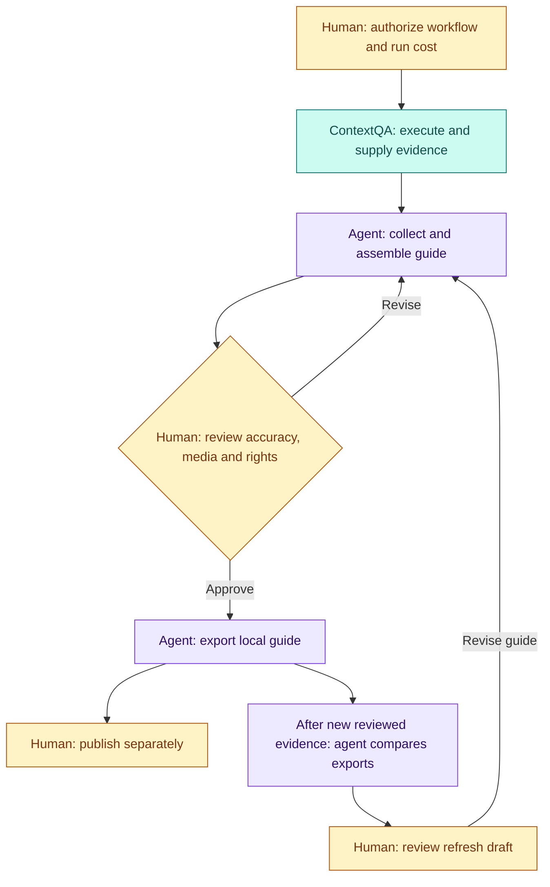

# ContextQA Docs Evidence

For **solutions engineers and technical writers**: turn selected ContextQA workflow evidence into reviewed guides, then compare versions when the application changes.

[Usage guide](docs/how-to-use.md) · [Technical guide](docs/POWERFUL.md) · [Capture and refresh](docs/capture-and-refresh.md) · [Proof status](docs/documentation-proof.md)

**Build your documentation agent:** customize the audience, evidence selection and review policy while reusing ContextQA execution and this renderer. [See it → try it → build it → own it](docs/custom-agent-builder.md).

## Salesforce-focused starter

[Salesforce context, testing and learning center](docs/salesforce/README.md): 24 reusable candidate scenarios, customer-context preparation, practical module guides, an eight-module learning path, market research and local landing-page drafts. [Try the offline adaptation tutorial](docs/salesforce/guides/adapt-assets.md). Templates are not executed tests; live customer evidence and publication require their own review.

## Who does what?

| Role | Responsibility in this repo |
|---|---|
| **ContextQA** | Executes authorized saved workflows and supplies actual results and available media as documentation evidence. |
| **Your custom agent** | Coordinates selected-result collection, explicit step/media assembly, local export and comparison using this toolkit. Optional AI drafts prose. |
| **Human in the loop** | Approves execution scope/cost, checks instructions and every selected image/video, confirms sharing rights, and reviews refresh drafts before publication. |



The agent is a coordinator you compose; **automatic recapture and destination publishing are not shipped**. Hash comparison flags changes for human interpretation. [Review checkpoints and an example](docs/POWERFUL.md#roles-and-human-review).

[Slide-style overview](assets/readme/overview.svg)

## Try it locally

Requires **Python 3.10+**; no runtime dependencies. From the repository root, choose a fresh output path:

```sh
python3 examples/contextqa_demo.py /tmp/NEW-contextqa-guide-preview
```

This is an **account-free API simulation**, not a live run or screenshot capture. For real evidence, follow the [usage guide](docs/how-to-use.md) and [API setup](docs/contextqa-api.md).

**Know the boundary:** review selected content and media before export. Standalone capture needs a separate producer; automatic recapture, semantic visual diff and native partner publishing are not implemented. [Kan evidence and remaining gates](docs/documentation-proof.md) are scoped separately.

**Local release candidate:** an MIT license is included; no public release has been made. Optional AI and hosted execution use separate credentials and may incur charges.

[Developer instructions](AGENTS.md) · [Security and publication](docs/security.md) · [Capability evidence](docs/capability-register.md)

## ContextQA as the documentation operator

[ContextQA-only writer workflow](docs/contextqa-writer.md): saved journeys perform the product activities; their execution results, screenshots and recordings support the guides. Reviewed changes produce before/after comparisons and immutable versions, with a pointer to the latest approved copy. A failed or stale run cannot advance that pointer. The prior manual-browser Learning Hub example is excluded from acceptance; it demonstrates layout only. Use the [agent instructions](agent-instructions/contextqa-writer.md) with `docs-writer collect` and `docs-writer finalize`; the agent supplies technical-writing judgment and visual review. The coordinator does not silently call a model or publish to a hosted documentation service. Semantic image comparison remains outside this implementation.

## Saved journeys and documentation refresh

The [journey agent](docs/journey-agent.md) connects source changes to saved ContextQA cases, checks definition drift, collects matching run evidence, and updates documentation with reviewed screenshots and video links. It runs from the CLI; remote test updates, execution and delivery remain explicit.

## Developer workflow without an app

Use the [CLI-first workflow](docs/cli-first.md) to prepare source-bound Markdown/MDX drafts, a Git patch and a local review record. No React, PostgreSQL or running server is required. `python3 -m cqa_artifacts.agent prepare` preserves the evidence and approval gates.

## Optional documentation review application

The new [documentation loop](docs/documentation-loop.md) provides a responsive review inbox, article editor, evidence gates and explicit draft delivery. Start with the real, historical [Kan PR #15 workspace](examples/kan-pr15/) or the synthetic account-free `examples/docs-loop/demo.py` fixture. See the [PageLoop research mapping](docs/pageloop-research.md) and [validation receipt](docs/documentation-loop-validation.md). The included server is operator-local; production hosting and live execution acceptance are separate gates.

### Hosted review console (React + PostgreSQL)

`apps/web` is the React review console; `cqa_artifacts/hosted` is the FastAPI API on PostgreSQL. The repository agent (`python3 -m cqa_artifacts.agent plan|validate|submit`) sends change sets to the same workspace. Checks: `npm test --prefix apps/web`, `npm run build --prefix apps/web`, and with a disposable database `TEST_DATABASE_URL=... python -m unittest discover -s tests-hosted`. See the [parity matrix](docs/parity-matrix.md) and the [2026-11-19 validation receipt](docs/hosted-validation-2026-11-19.md) for what is and is not verified.
