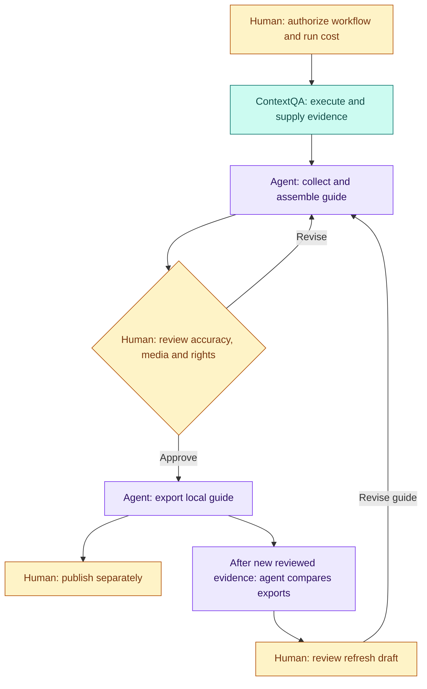

# ContextQA Docs Evidence

For **solutions engineers and technical writers**: turn selected ContextQA workflow evidence into reviewed guides, then compare versions when the application changes.

[Usage guide](docs/how-to-use.md) · [Technical guide](docs/POWERFUL.md) · [Capture and refresh](docs/capture-and-refresh.md) · [Proof status](docs/documentation-proof.md)

## Who does what?

| Role | Responsibility in this repo |
|---|---|
| **ContextQA** | Executes authorized saved workflows and supplies actual results and available media as documentation evidence. |
| **Your custom agent** | Coordinates selected-result collection, explicit step/media assembly, local export and comparison using this toolkit. Optional AI drafts prose. |
| **Human in the loop** | Approves execution scope/cost, checks instructions and every selected image/video, confirms sharing rights, and reviews refresh drafts before publication. |



The agent is a coordinator you compose; **automatic recapture and destination publishing are not shipped**. Hash comparison flags changes for human interpretation. [Review checkpoints and an example](docs/POWERFUL.md#roles-and-human-review).

[Slide-style overview](assets/readme/overview.svg)

## Try it locally

Requires **Python 3.10+**; no runtime dependencies. From the repository root, choose a fresh output path:

```sh
python3 examples/contextqa_demo.py /tmp/NEW-contextqa-guide-preview
```

This is an **account-free API simulation**, not a live run or screenshot capture. For real evidence, follow the [usage guide](docs/how-to-use.md) and [API setup](docs/contextqa-api.md).

**Know the boundary:** review selected content and media before export. Standalone capture needs a separate producer; automatic recapture, semantic visual diff and native partner publishing are not implemented. [Kan evidence and remaining gates](docs/documentation-proof.md) are scoped separately.

**Private candidate:** no open-source license or public release yet. Optional AI and hosted execution use separate credentials and may incur charges.

[Developer instructions](AGENTS.md) · [Security and publication](docs/security.md) · [Capability evidence](docs/capability-register.md)
