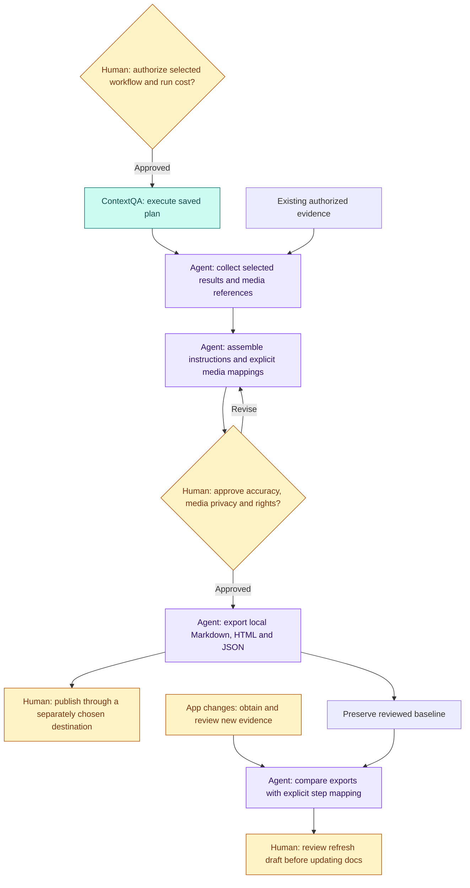

# ContextQA Docs Evidence — technical guide

[← Visual overview](../README.md)

This guide contains the detailed operating procedures, capability boundaries and reference links moved from the README. Commands run from the **repository root**, even though this document lives in `docs/`.

## Technical navigation

[Build a documentation steward](custom-agent-builder.md) · [Roles and human review](#roles-and-human-review) · [How to use](#how-to-use) · [What works now](#what-works-now) · [Quick start (Python 3.10+; no runtime dependencies)](#quick-start-python-310-no-runtime-dependencies) · [After the app changes](#after-the-app-changes) · [Existing evidence sources](#existing-evidence-sources) · [Documentation](#documentation) · [Optional documentation destinations](#optional-documentation-destinations) · [Verification](#verification) · [Optional AI with your own key](#optional-ai-with-your-own-key) · [Product strategy and release plan](#product-strategy-and-release-plan) · [Install and test for real](#install-and-test-for-real) · [Kan documentation proof and capture improvements](#kan-documentation-proof-and-capture-improvements)

## Roles and human review

ContextQA is the execution/evidence producer for the primary workflow. It runs the authorized saved plan in the configured customer application and exposes actual results and available artifacts. The wrapper imports selected evidence; it does not itself crawl or capture the application. Existing authorized results can be collected without starting a new run. The [Kan receipt](verification-2026-10-30.md) is scoped evidence, not universal token-adapter, tenant or deployed-change acceptance.

A **custom agent** here is an operator-composed coordinator around the CLI/library, not a shipped autonomous documentation service. The existing tools support selected-result collection, explicit instructions/media mapping, reviewed local exports and comparisons. Optional AI can draft from text approved for sharing; it cannot approve evidence, run browser actions or publish. Automatic client-instruction loading, deployment-to-recapture orchestration and destination publishing still require implementation. Today an operator follows the documentation style template during drafting and review.

| Checkpoint | Agent prepares | Human decides | What happens next |
|---|---|---|---|
| Evidence acquisition | Selected saved plan and configuration, or existing result IDs | Is the environment/workflow appropriate, and is any new run's effect/cost authorized? | ContextQA executes only an approved run; the coordinator polls its accepted ID and selects real member results. |
| Guide assembly | Candidate instructions, explicit step/media mapping, capture labels and annotations | Do instructions match observed behavior? Is every image/video appropriate to share, with permission? | Correct or remove unsuitable content, then record a hash-bound content/media approval. Text filtering does not sanitize pixels or audio. |
| Export and delivery | Markdown, static HTML, JSON, attached assets and handoff files | Is the guide appropriate for the intended audience and destination? | Export local files, then publish separately through the chosen destination. The wrapper does not host or upload the guide. |
| Application change | Separate reviewed before/after exports, release context and explicit step matching | Is the changed text/media meaningful, and does the proposed update remain accurate? | Review the refresh draft, update affected documentation and reapprove changed content. Preserve the original baseline. |

**Example:** a “Create a project” guide needs a new button label. After the owner authorizes a new capture, ContextQA executes the workflow. The coordinator collects the selected results, and a human matches the new screenshot to the correct instruction and checks privacy/rights. A new reviewed export is compared with the baseline using explicit step mapping. The documentation owner accepts or edits the refresh draft and publishes separately. A changed image hash alone cannot establish that the button changed.

Review is required again after changes to text, metadata, annotations or media. Approval establishes review of those bytes, not that a product behavior or revision claim is true. Native Layerpath/EkLine publication remains unimplemented; the Kan trigger prepares requests rather than completing the full deployed-change loop. See [operator workflow](how-to-use.md), [API run safety](contextqa-api.md), [security](security.md) and [proof status](documentation-proof.md).

### Detailed approval flow



## Implementation map

| Layer | Implementation | Detailed contract |
|---|---|---|
| CLI and workspace lifecycle | `cqa_artifacts/__main__.py`, `cqa_artifacts/core.py` | [Usage](how-to-use.md) |
| ContextQA operations and results | `cqa_artifacts/contextqa.py`, `cqa_artifacts/project.py` | [API operations and safety](contextqa-api.md) |
| Selected media retrieval | `cqa_artifacts/media.py` | [Media boundaries](contextqa-api.md#october-30-selected-media-retrieval) |
| Reviewed comparison | `cqa_artifacts/changes.py` | [Capture and refresh](capture-and-refresh.md) |
| Optional AI drafting | `src/ai.js`, `scripts/prepare-ai-input.py` | [AI consent and privacy](ai.md) |
| Kan request preparation | `integrations/kan/docs_request.py` | [Triggers](documentation-triggers.md) |

ContextQA Docs Evidence helps solutions engineers and technical writers turn reviewed workflow evidence into documentation they can refresh when the app changes. Use ContextQA saved tests and results as the evidence source, then review and export a local guide. This candidate includes an explicit ContextQA API client; standalone browser capture still comes from a separate producer.

**Workflow:** capture a known task → select screenshots → attach to instructions → review → export a guide → repeat after a release → supply change context → compare explicitly matched steps → review the documentation update.

Built around [ContextQA](https://contextqa.com/?utm_source=github&utm_medium=developer_referral&utm_campaign=contextqa_docs_evidence&utm_content=readme_overview) workflow evidence. Start with the [recorder guide](https://contextqa.com/tutorials/no-code-test-automation-recorder/?utm_source=github&utm_medium=developer_referral&utm_campaign=contextqa_docs_evidence&utm_content=readme_capture_guide) or read about [visual baselines and change review](https://contextqa.com/blog/visual-regression-testing-ui-stability/?utm_source=github&utm_medium=developer_referral&utm_campaign=contextqa_docs_evidence&utm_content=readme_visual_regression_blog).

**Release status:** private candidate; an open-source license and public release are pending owner approval. Core local samples make no model or ContextQA SaaS calls. Optional AI and hosted execution use separate credentials and may incur provider charges.

## How to use

Start with the [onboarding-to-documentation usage guide](how-to-use.md), then choose a [GitHub Actions or external trigger](documentation-triggers.md). The guide includes a [client documentation-instructions template](../examples/documentation-lifecycle/DOCUMENTATION_STYLE.md) and a proposed section/test/module manifest. Automatic client-skill loading and deployed-change recapture are extension work; the existing Kan workflow prepares requests only.

## What works now

- Import candidate actions and screenshot frames from bounded Playwright trace ZIPs. Raw trace, DOM and network details stay private.
- Attach local PNG/JPEG/WebP screenshots and independently recorded MP4/WebM videos to steps.
- List/read and explicitly author ContextQA cases, steps, suites and plans using 26 contract-derived JSON operations.
- Start one approved saved ContextQA plan with a durable local journal, poll within bounds, and collect selected member results into review-required guide steps. No blind execution retry or fabricated screenshots. Selected private media retrieval now requires an explicitly reviewed storage host.
- Require content/media review, bound to hashes, before exporting Markdown with attached images, a static HTML walkthrough, JSON, an iframe snippet and partner handoff instructions.
- Compare reviewed before/after exports with release context and explicit step matching. Produce a documentation refresh draft and machine-readable changes.

The wrapper does not capture browsers itself, infer which screenshot belongs to which step, perform pixel/semantic regression analysis, update external documentation automatically, create a live application clone, or call undocumented partner APIs. Comparison reports changed text or media hashes; animation, timestamps or encoding can change hashes without meaningful UI changes.

## Quick start (Python 3.10+; no runtime dependencies)

Run from this directory, or install with `python3 -m pip install .` and use `cqa-artifacts`.

```sh
python3 -m cqa_artifacts init workspaces/release-a --title 'Create a project — release A'
python3 -m cqa_artifacts add-step workspaces/release-a --title 'Open Projects' --instruction 'Select Projects in the left navigation.'
python3 -m cqa_artifacts add-media workspaces/release-a --kind screenshot --file /absolute/path/reviewed-screenshot.png
# Use the returned media_id:
python3 -m cqa_artifacts attach workspaces/release-a --step 1 --media-id MEDIA_ID
python3 -m cqa_artifacts approve workspaces/release-a --reviewer 'Documentation owner' --confirm-rights-and-reviewed-content
python3 -m cqa_artifacts export workspaces/release-a --out exports/release-a --base-url https://docs.example.com/walkthroughs/release-a
```

The base URL generates an embed snippet; nothing is hosted or uploaded. `guide.md` uses relative image attachments. When moving a guide into a docs system, upload its assets and rewrite relative links for that system. Keep video attachments separate if the destination cannot embed them.

Only confirm review after inspecting every selected frame/video for personal data, credentials, proprietary content and metadata, and verifying permission to share it. Text filtering is incomplete and never sanitizes pixels or video audio. The CLI is a trusted single-user local prototype, not a multi-tenant security boundary.

## After the app changes

Capture the same task under the same role, locale, viewport and seeded data on the new version. Create and review a separate workspace/export; preserve the baseline. Copy `examples/change-context.json`, then edit the version labels, actual change explanation, affected documents and step mapping.

```sh
python3 -m cqa_artifacts compare exports/release-a --after exports/release-b --context examples/change-context.json --out exports/change-review
```

Every old and new step must be mapped exactly once. `null` marks an added or removed step; reordered steps can be paired explicitly. Both exports need unchanged review receipts. Read `refresh-draft.md` alongside both exports; `changes.json` identifies their step numbers and attached media IDs. The comparison HTML includes only media from the two reviewed exports, labeled Before and After. Approval does not establish that product behavior is correct or that a claimed change actually happened.

## Existing evidence sources

```sh
python3 -m cqa_artifacts import-trace workspaces/release-a --file /absolute/path/trace.zip
python3 -m cqa_artifacts edit-step workspaces/release-a --step 1 --title 'Open Projects' --instruction 'Select Projects in the left navigation.'
python3 -m cqa_artifacts inspect workspaces/release-a
```

A trace is not a complete video. Record video separately if required. Imported action parameters, selectors, filled values, network responses and DOM snapshots are not copied into public output. Trace frame extraction is a bounded, best-effort parser for the observed NDJSON event shape; Playwright's internal archive format can change.

For ContextQA-first execution and collection, see [exact API operations, tokens, scopes and run safety](contextqa-api.md) and the [platform configuration map](contextqa-platform.md). A superadmin creates a scoped token in **Settings → API tokens**; inject it as `CONTEXTQA_API_TOKEN` through your secret manager. API entitlement and charges need account-specific confirmation.

```sh
# Account-free complete API-to-guide simulation; no live execution or image claim:
python3 examples/contextqa_demo.py /tmp/NEW-contextqa-guide-simulation
python3 -m cqa_artifacts contextqa-operations
# Real selected existing results, only after scoped access is authorized:
python3 -m cqa_artifacts contextqa-collect workspaces/release-a --run-id RUN_ID --case-result-id CASE_RESULT_ID --step-result-id STEP_RESULT_ID --import-steps
```

Use a fresh empty workspace for `--import-steps`; replace IDs with actual integers. Candidate steps require human review before export. Known artifact references and full plan/profile/result snapshots stay private. Existing ContextQA environments, data profiles, prerequisites and cross-browser/parallel plan settings drive the remote run; this package does not invent their IDs or configuration endpoints. The older `collect` command remains a narrow read-only compatibility path; prefer `contextqa-collect` for strict selected-ID validation and guide import.

[Run once and poll safely](contextqa-api.md#start-once-then-poll-the-accepted-run) documents the separate `contextqa-run --approve-execution` opt-in. It may bill, is non-idempotent and cannot be stopped through the supplied token API. Local journals prevent reuse but do not guarantee upstream exactly-once execution. No live run was performed to test this integration.

## Documentation

- [Use cases and partner workflows](use-cases.md)
- [Capture and refresh playbook](capture-and-refresh.md)
- [Growth experiment](growth-experiment.md)
- [Security and publication boundaries](security.md)
- [Sources and capability limits](sources.md)
- [Browser automation product scope](product-scope.md)
- [ContextQA resources and attribution](contextqa-resources.md)

## Optional documentation destinations

The primary path uses ContextQA to execute the customer application, then this repository to review, export and compare documentation. Layerpath and EkLine are optional destinations, not requirements or implemented connectors.

- [Layerpath integration brief](layerpath-integration.md): responsibilities, setup, baseline-to-refresh walkthrough and interface decisions for the Layerpath team.
- [Layerpath handoff runbook](../examples/layerpath-lifecycle/README.md): proposed use of reviewed ContextQA assets in a tour-authoring destination.
- [EkLine handoff runbook](../examples/ekline-lifecycle/README.md): proposed use of approved prose/assets in a documentation editor.
- [Core completion requirements](completion-requirements.md): evidence and implementation needed for the ContextQA-led lifecycle, with optional destination acceptance kept separate.

Both native examples remain **unexecuted runbooks**. Historical sign-in reports do not establish current features, native drafts, API adapters or publishing support. The verified core example is [Kan's ContextQA execution receipt](verification-2026-10-30.md); broader application coverage and automatic deployed-change refresh remain incomplete.

## Verification

```sh
python3 -m unittest discover -s tests -v
python3 examples/demo.py /tmp/NEW-cqa-docs-evidence-demo
python3 examples/contextqa_demo.py /tmp/NEW-contextqa-guide-simulation
```

The first demo uses synthetic text; the ContextQA demo uses simulated API transport. Neither records a real app, creates video, calls a live API or establishes live test success. Guides label simulation explicitly. Source code and documentation may be shared separately from customer evidence. No open-source license has been granted in this private prototype.

## Optional AI with your own key

Use OpenAI, Claude/Anthropic or an OpenAI-compatible provider from your own local process. [Provider configuration, consent, usage metrics and privacy](ai.md). AI drafts require explicit sharing approval and never execute browser actions, approve evidence or publish content. Keys stay in environment variables or your secret manager.

## Product strategy and release plan

[Growth strategy and two-recipe specification](GTM.md) · [Capability evidence](capability-register.md) · [Prioritized implementation backlog](backlog.md) · [Audience and fair comparisons](comparisons.md). These are local release drafts; proposed API flows, commands and commercial claims are explicitly gated. No public open-source release or hosted service is implied.

## Install and test for real

Follow the [fresh-install and real-testing guide](real-testing.md) for observed test coverage, a reproducible local path, expected failures and the remaining live-account acceptance checks. Synthetic browser results are separate from real source/AI credentials and customer staging workflows.

## Kan documentation proof and capture improvements

See [the live-proof status and exact remaining gates](documentation-proof.md). This revision adds review-bound capture labels, screenshot callouts in HTML, selected private media retrieval, and a Kan PR-to-documentation request mapper. It also prevents new result IDs alone from marking an unchanged guide as changed.

```sh
python3 -m cqa_artifacts capture-context workspaces/release-a --file private/context.json
python3 -m cqa_artifacts annotate workspaces/release-a --step 1 --file private/annotations.json
# Review again after metadata, instructions or annotations change.
```

MCP/Max execution and the full deployed-change→recapture→review loop still need live acceptance. Only ContextQA execution and ContextQA-produced media are accepted for the Kan demo; browser previews are excluded.
