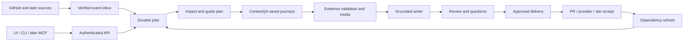

# Proposed architecture and implementation contracts

This is our implementation design, not a claim about Pageloop internals. Preserve the existing modular Python engine and React app. First deployment: web/API process, durable worker process, PostgreSQL and private object storage. Add a separately scheduled dispatcher. A PostgreSQL job queue is sufficient for the initial scope; avoid adding another broker until measurements justify it.

## Data contract

Every scoped object carries organization_id and project_id. Composite foreign keys or equivalent constrained lookups prevent cross-tenant relationships. The request principal comes from authenticated identity, never a submitted actor field.

| Entity | Essential fields / invariants |
|---|---|
| Workspace/membership | Identity, role, invitation/deactivation status; preserve one active admin |
| Connection | Provider, secret reference, scopes, configured resources, status, last health check; no secrets in public DTOs |
| Source event | Provider delivery ID, revision, resource, occurred/received time, payload digest; tenant-scoped dedupe key |
| Workflow/version | Trigger, timezone, steps, referenced resources, immutable version and activation state |
| Run/attempt/job | Trigger event, workflow version, stage, state, lease, attempt, provider run ID, idempotency key, budget policy, failure class |
| Article/version | Stable page ID, path, source commit, title/body/metadata hash, published and draft pointers |
| Navigation/config | Versioned graph/config hash; distinct from page paths and titles |
| Journey/version | Saved ContextQA IDs, definition digest, target environment, expected assertions and capture checkpoints |
| Evidence/figure | Run/case/step linkage, deployment binding, artifact checksum, frame timestamp, crop/redaction lineage, review state |
| Claim/dependency | Claim or section ID → source revision, journey checkpoint or figure; supports selective refresh |
| Change set/entry | Baseline, operation, before/after hashes, decision, revision, reviewer; page/body/assets/navigation/metadata |
| Question round | Questions/choices, decision controlled, saved answers, submitted revision, continuation run |
| Approval | Content/media/source/destination digest, reviewer, time and current review version |
| Delivery/publication | Intent, target, provider receipt/PR/commit, ambiguous state, merge/build/live verification timestamps |
| Audit/notification | Actor, operation, object revision and outcome; outbox key and delivery status; secrets excluded |

Do not store large artifact bytes or unlimited history inside the current project JSONB row. Introduce migrations for jobs, connections, media and receipts first. Preserve existing domain operations behind a service interface while progressively extracting articles/change sets. Migration tests must load existing project state and verify no approved version or evidence link is lost.

## Separate state machines

- Workflow: draft → live ↔ paused; attention is a derived condition. Pausing blocks new dispatch, not an already accepted remote run.
- Run: queued → researching → planning_capture → capturing → drafting → checking → needs_review / no_change. Any stage may need_input or fail. Ambiguous provider acceptance is a reconciliation state, not retryable failure. A continuation references its predecessor and saved input version.
- Review: open → needs_input → in_review → ready → approved. Editing source/content/media/destination invalidates approval. Assignment/archive/resolved flags do not prove publication.
- Delivery: not_started → intent_recorded → submitting → submitted / partial / failed / ambiguous → merged → build_pending → live_verified. Help-center draft delivery stops at provider_draft until public visibility is separately checked.
- Evidence: planned → bootstrap_observed → replay_verified → media_reviewed; failed, stale and inconclusive remain explicit. Deployment binding is independent of pass/fail.

## Proposed API additions

Retain `/api/orgs/{org}/projects/{project}` as the scoped base. Existing actions remain adapters during migration. New resource routes below are **not currently implemented**.

| Route family | Contract |
|---|---|
| `connections`, `connections/:id/health` | Admin configuration, scoped discovery, reconnect/disconnect; scrubbed settings |
| `imports`, `imports/:id` | Preview selected source inventory, start/resume/retry failed entries, report collisions |
| `workflows`, `workflows/:id/versions` | Draft CRUD with expected_version; explicit activation/pause/test/backlog handling |
| `runs`, `runs/:id`, `runs/:id/questions` | Idempotent internal start; bounded cursor reads/events; versioned answer submission |
| `journeys`, `journeys/:id/maintenance` | ContextQA references and planned changes; separate authorization for authoring/run |
| `change-sets`, `change-sets/:id/entries` | Typed operations and optimistic revision; partial decisions visible |
| `change-sets/:id/approve`, `deliveries` | Bind approval to exact digest; persist intent before external write |
| `articles/:id/versions`, `artifacts/:id` | Authorized version/media access; short-lived artifact URLs generated at read time |
| `health/findings`, `dependencies` | Bounded actionable findings and affected pages/claims/figures |

Mutation requests use expected_version or If-Match; stale writes return conflict with current revision. Internally idempotent starts accept a client_request_id and return the original job on replay. List responses use cursor/limit and scoped totals. Failures return code, safe message, retryability, failed stage and correlation ID, never provider secrets/raw error bodies.

## Async and external effects

Persist event+job intent transactionally; lease jobs with heartbeat and bounded expiry. Redelivery must reuse the same event/run identity. Safe reads may back off on rate limits. Non-idempotent ContextQA start remains one-attempt journalled: if send/response persistence is uncertain, block automatic retries and reconcile. A new filename or internal job ID does not make that trigger safe. Worker cancellation cannot be advertised as upstream cancellation when the provider lacks it.

Use an outbox for notifications and delivery requests. Retain provider operation identifiers and payload digests. Avoid holding a project DB lock during a model call, capture or Git push. Commit stage output atomically and resume from persisted artifacts. Bound source pages, diff bytes, model tokens, capture count and wall-clock policy; unknown actual provider cost stays unknown.

## Security and publication boundaries

Validate webhook signatures and resource authorization. Isolate tokens in secret storage; avoid returning raw environment values. Fetch/import services need controlled outbound hosts, size/time limits and redirect handling. Treat source text/model output as data. MDX must not execute arbitrary imports, JavaScript or event handlers. Private evidence access is checked server-side, including thumbnails and download URLs. Redaction produces a derivative with lineage; it never fabricates product controls.

Our first release requires explicit approval for delivery. Pageloop's MCP docs describe a separately granted Publish live capability; that is a reference capability, not permission to remove our approval boundary. If delegated publication is introduced later, define revocation, scope, expiry and audit explicitly.

## Refresh semantics

Index dependencies at section/figure level. Detect source changes, then evaluate relevance; changed hashes alone do not prove changed meaning. Deployment mismatch queues a wait-for-release state. Reuse approved unaffected sections; retain human-authored text outside managed blocks. Regeneration compares semantic content while ignoring non-content timestamps. No-change work creates a receipt, not a new current guide. A failed refresh retains the last approved/live version and displays its freshness warning.
