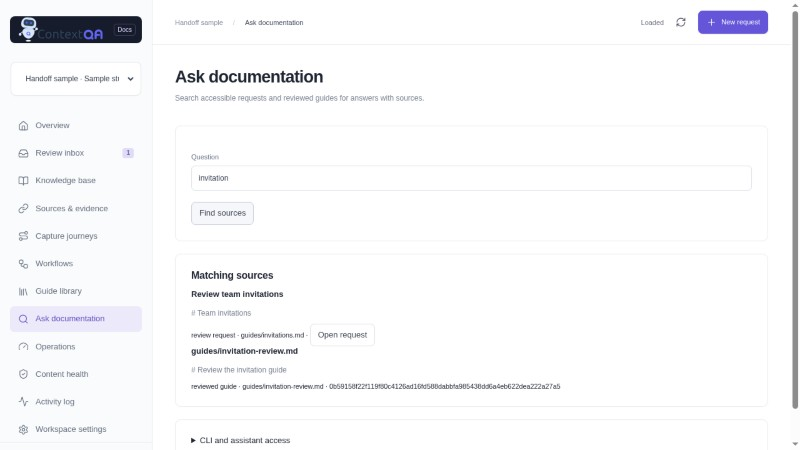
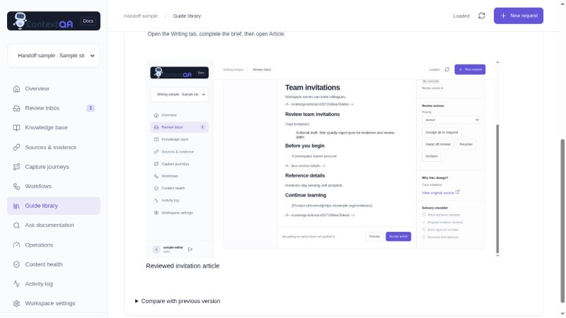
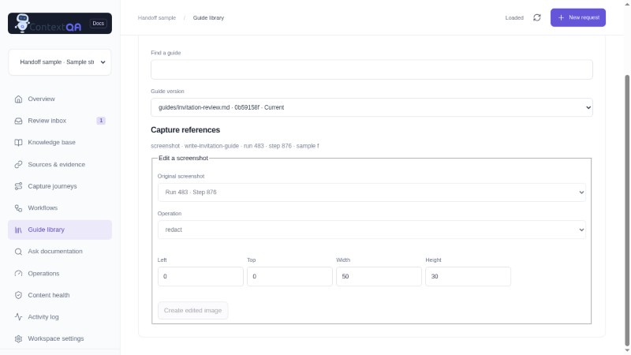
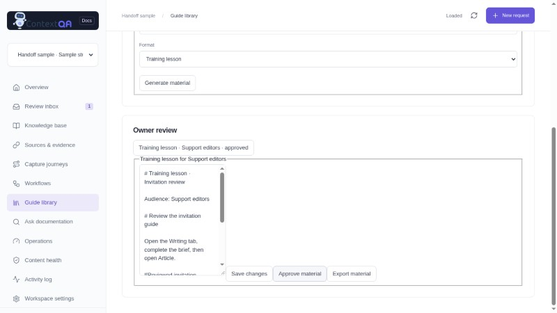
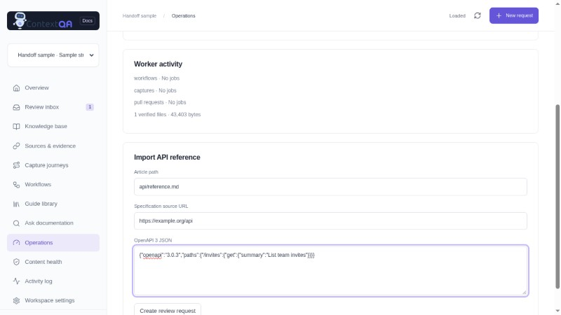
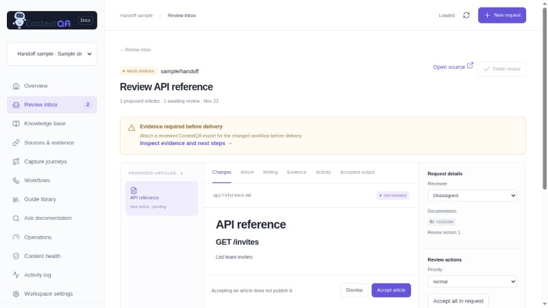
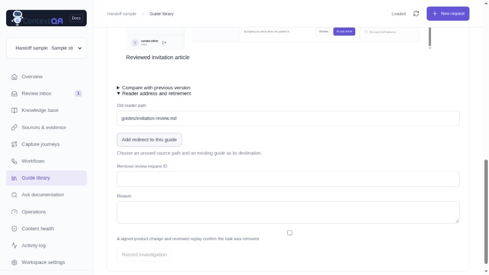
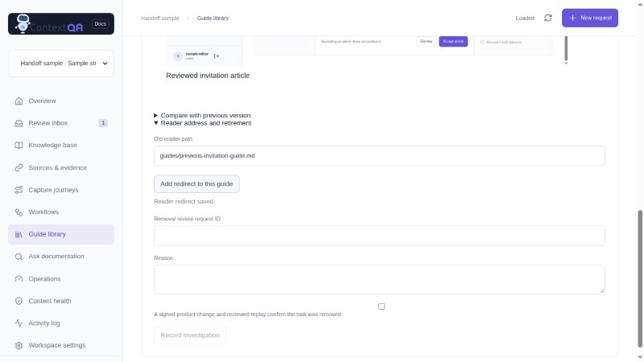

# Find a guide, inspect its evidence and export a training lesson

Use a current, approved guide when you need training material that reflects what the product actually does. In this walkthrough the source is an invitation guide. The illustrated source was seeded into an isolated workspace using the screenshot from Ship 5 result 483. Ship 5 subsequently operated the documentation app to generate, approve and export the lesson.

## Find and read the source

1. Open **Ask documentation**, enter a search term such as **invitation**, then select **Find sources**. The results show an excerpt, source type, and an article path or request. A reviewed guide includes its version. Open the request to inspect proposed changes. If there are no matches, try the label used in the product.
2. Open **Guide library** and select the path and version under **Guide version**. Use the **Current** version for a new lesson. Expand **Compare with previous version** to see the content diff and media counts.

The search journey returned a versioned article, a review request and an empty result for a different query. [Watch the search clip](studio-evidence/citation-search.mp4) · [Inspect Ship 5 result 488](https://ship-5.contextqa.com/run-result-view?testCaseId=221&runResultId=488)

## Inspect and edit a screenshot

1. Under **Guides**, read the article and check that the illustration shows the documented step.
2. Choose **Evidence media**. Read the journey, run and step references. In this guide they point to run 483 and step 876.
3. Choose the original screenshot, the **redact**, **crop** or **outline** operation, and its rectangle in pixels. Select **Create edited image**. Use **Download edited PNG** to inspect or deliver that derivative. Its pixels are saved separately from the original. A guide version continues to identify the media its editor approved.

## Create and approve the lesson

1. Choose **Enablement**. Enter the audience, select **Training lesson**, and choose **Generate material**.
2. Under **Owner review**, inspect the wording and linked evidence. Save any edits. Select **Approve material** after checking the text against the source guide.
3. Select **Export material** and check the export confirmation. Extract the ZIP. Open the Markdown inside its **docs** directory and follow the image link. The archive includes the referenced file. When the source changes, the existing material is marked stale and requires a new review.

The export journey checked the original illustration, run and step references, edited-image control, owner approval and export confirmation. A separate PostgreSQL query verified the stored approval and export timestamp. [Watch the export clip](studio-evidence/training-export.mp4) · [Inspect Ship 5 result 491](https://ship-5.contextqa.com/run-result-view?testCaseId=220&runResultId=491) · [Inspect database-backed result 492](https://ship-5.contextqa.com/run-result-view?testCaseId=225&runResultId=492)

## Import an OpenAPI operation for review

1. Open **Operations** and scroll to **Import API reference**. Enter the specification source URL and paste the OpenAPI 3 JSON. For this example the specification defines **GET /invites** with the summary **List team invites**.
2. Choose **Create review request**. In **Review API reference**, read the operation, path and description. Check the generated content against the source before sending it for review. An unsupported format produces a validation error.
3. If the request needs an illustration, attach reviewed ContextQA evidence for the procedure before approval. The import creates a proposal. Publication requires review and delivery.

The first broad run timed out. A focused rerun verified the new request after the app refreshed its inbox on import. [Watch the import](studio-evidence/openapi-import.mp4) · [Inspect Ship 5 result 494](https://ship-5.contextqa.com/run-result-view?testCaseId=226&runResultId=494)

## Redirect an old reader address

1. In **Guide library**, choose the current version of the destination guide. Expand **Reader address and retirement**.
2. Under **Old reader path**, enter the path readers used previously. Choose **Add redirect to this guide**. If the path is occupied, the reason appears below the button. Here the editor entered the destination guide's own path.

3. Replace the occupied path with the unused old address, then choose **Add redirect to this guide** again. Look for **Reader redirect saved** beside the button. The API verification also followed an old path and checked that it resolved to the destination guide's exact version.

[Watch the corrected redirect](studio-evidence/reader-redirect.mp4) · [Inspect the Ship 5 browser result](https://ship-5.contextqa.com/run-result-view?testCaseId=228&runResultId=499) · [Inspect the API result](https://ship-5.contextqa.com/run-result-view?testCaseId=227&runResultId=495)
