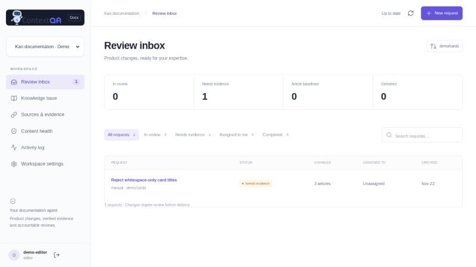
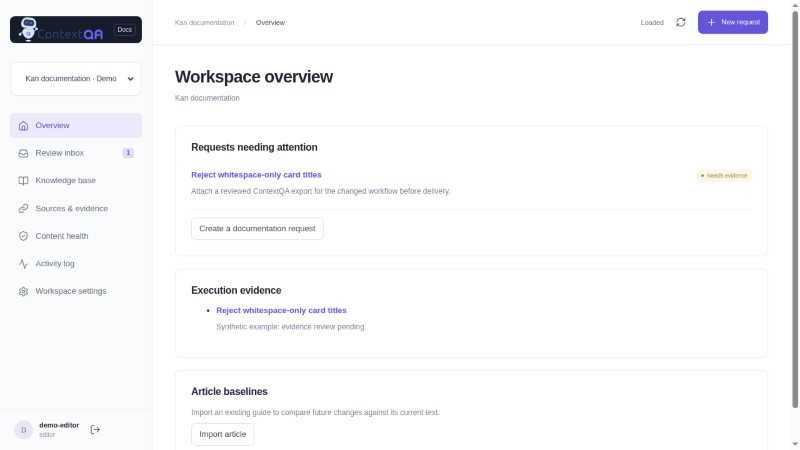
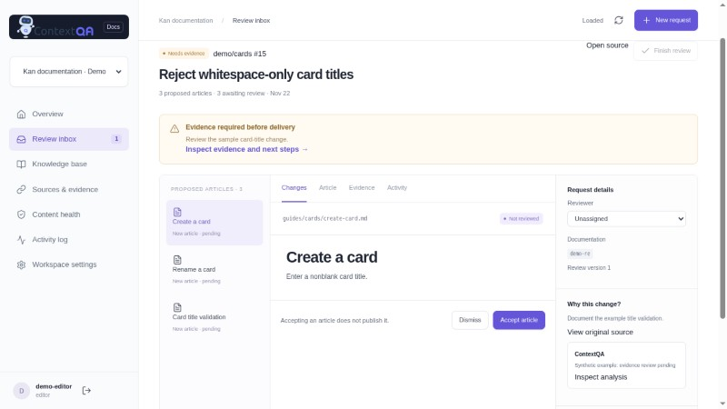
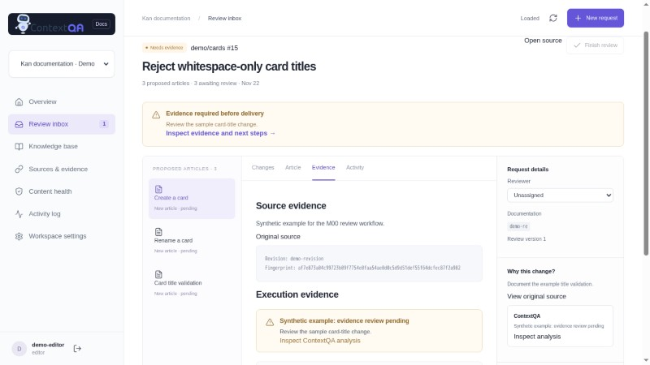
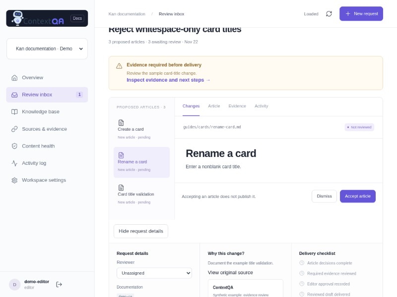
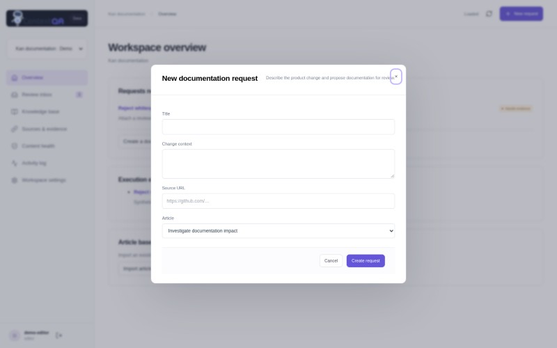
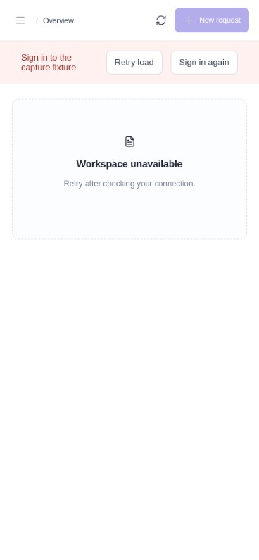
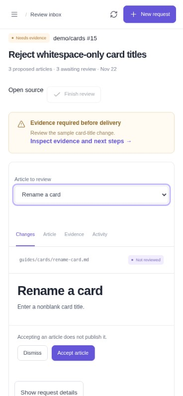

# Find a documentation request and check its evidence

Use this walkthrough when you need to decide why a guide update is waiting for review. It follows an editor in the **Kan documentation** demo workspace. Both builds use the same synthetic request and article proposals. The captured browser interactions are real. The card-title evidence displayed inside the example request is fixture data.

## What changed on arrival

The earlier build opened **Review inbox**, where the editor found the request in a table. M00 opens **Workspace overview**. Under **Requests needing attention**, an editor can see the request title, its status, and the outstanding question before opening it. The Review inbox is still available in the navigation.

*Before, result 459. The table contains one request with the Needs evidence status.* [Watch the before walkthrough](m00-evidence/before-walkthrough.mp4)

*After, result 460. The overview puts the required capture beneath the request title and lists the imported evidence summary below the queue.* [Watch the M00 walkthrough](m00-evidence/after-walkthrough.mp4)

## Inspect the proposed guide update

1. Open **Kan documentation** with editor access. On **Workspace overview**, find **Reject whitespace-only card titles** under **Requests needing attention**.
2. Select the request title. Check the request heading and the **Evidence required before delivery** notice. The example has three proposed articles. Selecting one shows its proposed content and decision controls.

3. Select the **Evidence** tab. Under **Source evidence**, check the change description, revision, and fingerprint. Under **Execution evidence**, read the supplied result and blocker. Here the example explicitly says its evidence review is pending. A successful run of this walkthrough verifies the documentation interface.

4. Return to **Review inbox**. Verify the same request is still listed. Opening the request and reading its evidence leaves its review decision unchanged.

The Chrome runs for this pair both used a 1280 × 720 CSS viewport. The linked clips begin after sign-in. Individual image and clip provenance, including step results and asset hashes, is recorded in the [capture manifest](m00-capture.json). See the [acceptance report](m00-acceptance-results.md) for compact layouts, keyboard behavior, negative cases, and unresolved issues.

## Keep the current article while inspecting its details

At a tablet width, open a request and select **Rename a card** in the article list. Select **Show request details**. The panel below the article contains its reviewer, the reason for the change, and the **Delivery checklist**. Select **Hide request details**. The same article should remain selected. ContextQA observed this at 1024 × 768 in result 461.

[Watch the tablet interaction](m00-evidence/tablet-details.mp4)

## Cancel a request with the keyboard

From **Workspace overview**, focus **Create a documentation request** and press Enter. When **New documentation request** opens, press Escape. The dialog closes, focus returns to the opener, and the existing request remains in the queue. ContextQA verified this sequence at 1440 × 900 in result 462.

[Watch the keyboard interaction](m00-evidence/keyboard-cancel.mp4)

## Recover access and review an article on a phone

1. If the test workspace rejects the access token, the page shows **Workspace unavailable**, **Retry load**, and **Sign in again**. The request title is hidden. Select **Sign in again**, enter the valid test credential, and select **Open workspace**. The **Workspace overview** appears.

2. Open **Reject whitespace-only card titles**. Under **Article to review**, choose **Rename a card**. Confirm the selected path is `guides/cards/rename-card.md`.
3. Select **Show request details** and scroll down to **Delivery checklist**. Select **Hide request details** and verify the same article path is still displayed. In result 463, ContextQA also verified that the primary controls on this review screen were reachable without horizontal scrolling.

[Watch the mobile article selection and details interaction](m00-evidence/mobile-review.mp4). The clip begins after successful sign-in. The recovery screenshot and the clip both come from case 200 at 390 × 844.
