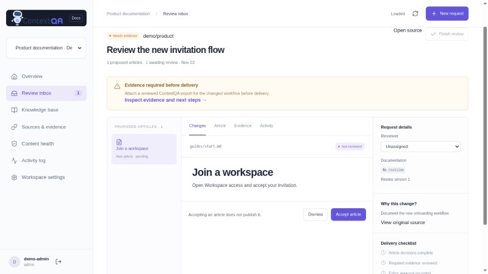
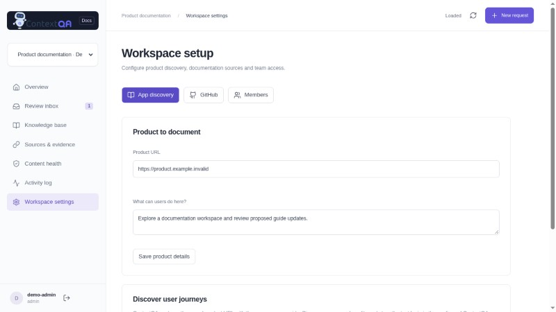
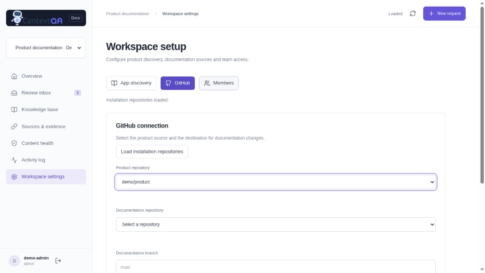
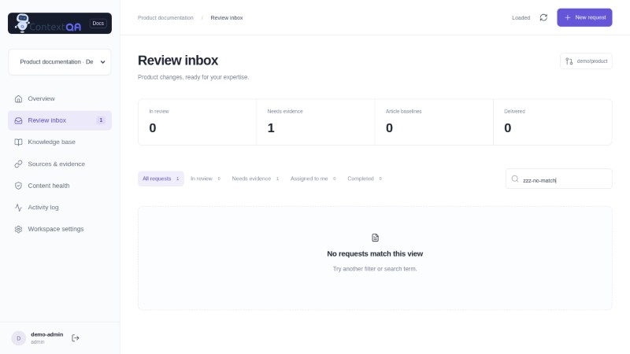
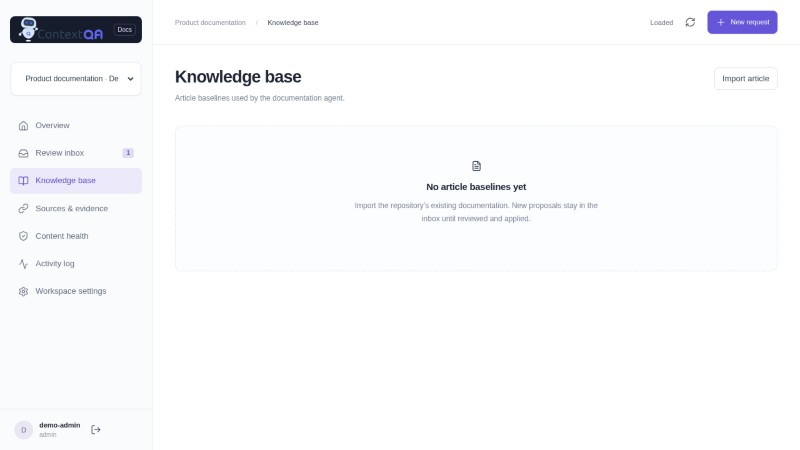
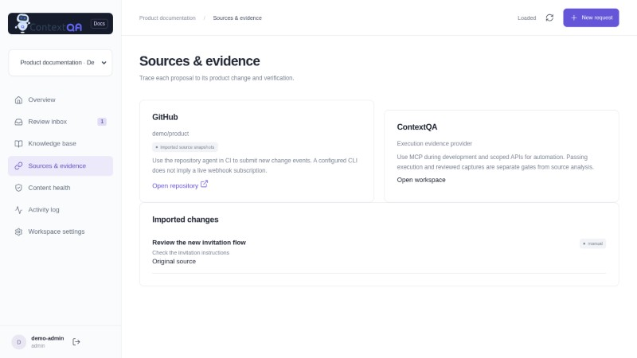
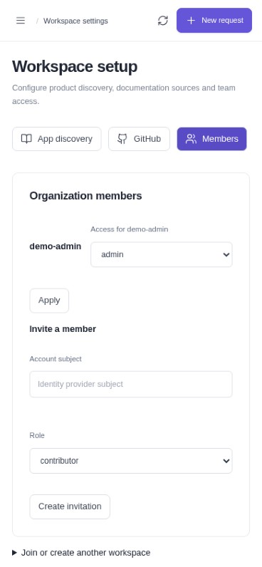

# Explore the documentation workspace and configure discovery

Use this guide as a workspace administrator to find a proposed guide change, identify the product ContextQA will explore, and locate the GitHub and member settings. The walkthrough uses the **Product documentation** synthetic workspace. Its example repository names and account are demonstration data.

## Inspect a proposed guide change

1. On **Workspace overview**, look under **Requests needing attention** and open **Review the new invitation flow**.
2. Read the **Evidence required before delivery** notice. In this sample, the **Changes** tab shows the proposed **Join a workspace** article and the delivery checklist. The notice identifies what still prevents delivery.

## Choose the app and repositories

1. Select **Workspace settings** in the sidebar. On **Workspace setup**, open **App discovery**. Under **Product to document**, check the **Product URL** and the description of the tasks users perform. The **Discover user journeys** section is below the saved app details.

2. Open **GitHub** and select **Load installation repositories**. Wait for **Installation repositories loaded**. Under **Product repository**, choose the source app. In this demonstration, the selected source is **demo/product**.
3. The next field is **Documentation repository**. This is the destination for guide changes. The separate **Documentation branch** and directory determine where approved files belong. The browser walkthrough stopped before saving a connection.

4. Open **Members** to inspect **Organization members**. The fixture shows **demo-admin** with the **admin** role. The **Invite a member** form asks for an account subject and role.

The original desktop capture shows a GitHub status message that persisted after switching tabs. The mobile capture below shows the corrected Members screen. [Original desktop frame](m01-m02-evidence/members.jpg)

[Watch the repository selection and switch to Members](m01-m02-evidence/workspace-setup.mp4). These frames and the clip come from Ship 5 case 201, result 465, step result 804, at a 1280 × 720 CSS viewport. [ContextQA case](https://ship-5.contextqa.com/td/cases/201/steps) · [Media provenance](m01-m02-evidence/provenance.json)

For a writable workspace, the [operator guide](m01-m02-operations.md) covers binding the tenant, starting discovery, accepting invitations, receiving signed pushes, compiling reviewed media and creating the documentation PR.

## Find an item and its supporting records

**Recover an empty search.** Open **Review inbox**, enter a search term with no matches and look for **No requests match this view**. The queue count remains visible. Clear **Search requests** to restore the full list. In the fixture, **Review the new invitation flow** reappeared. [Watch the search recovery](m01-m02-evidence/workspace-navigation.mp4)

**Check whether a baseline exists.** Open **Knowledge base**. The fixture displays **No article baselines yet** and offers **Import article**. A proposed article can appear in the inbox before a baseline is present.

**Find the source of a proposal.** Open **Sources & evidence**. Inspect the **GitHub** and **ContextQA** cards, then find the request under **Imported changes**. This example is labeled manual. To configure a connection, use **Workspace settings → GitHub**.

**Inspect health and history.** Open **Content health** to find coverage, stale articles, broken relative links, and **Run checks again**. Open **Activity log** to see the recorded action and actor. The capture fixture supplied an empty issues list. The case verified navigation and the available action, so the sample counts should not be used to assess real documentation health. [Health screen](m01-m02-evidence/content-health.jpg) · [Activity log](m01-m02-evidence/activity-log.jpg)

Ship 5 case 202 recorded this sequence at 1280 × 720 in result 466, step result 805. Combined with the setup journey, this covers the seven primary navigation destinations for this administrator. Additional roles, dialogs, data states and write workflows have their own acceptance criteria. [ContextQA case](https://ship-5.contextqa.com/td/cases/202/steps) · [Media provenance](m01-m02-evidence/workspace-navigation-provenance.json)

## Open the invitation form on a phone

1. On **Workspace setup**, open **GitHub** and tap **Load installation repositories**. The confirmation appears below the tabs. [GitHub confirmation on mobile](m01-m02-evidence/mobile-github.jpg)
2. Tap **Members**. The confirmation clears. Under **Organization members**, check the current member and role.
3. Under **Invite a member**, locate **Account subject**, **Role**, and **Create invitation**. All three fit within the 390-pixel viewport. The read-only journey ended before submitting an invitation.

[Watch the switch from GitHub to Members on mobile](m01-m02-evidence/mobile-members.mp4). Ship 5 case 203, result 467, step result 806, used a 390 × 844 CSS viewport and the final frontend asset `index-x-1P2AWL.js`. [ContextQA case](https://ship-5.contextqa.com/td/cases/203/steps) · [Media provenance](m01-m02-evidence/mobile-members-provenance.json)
