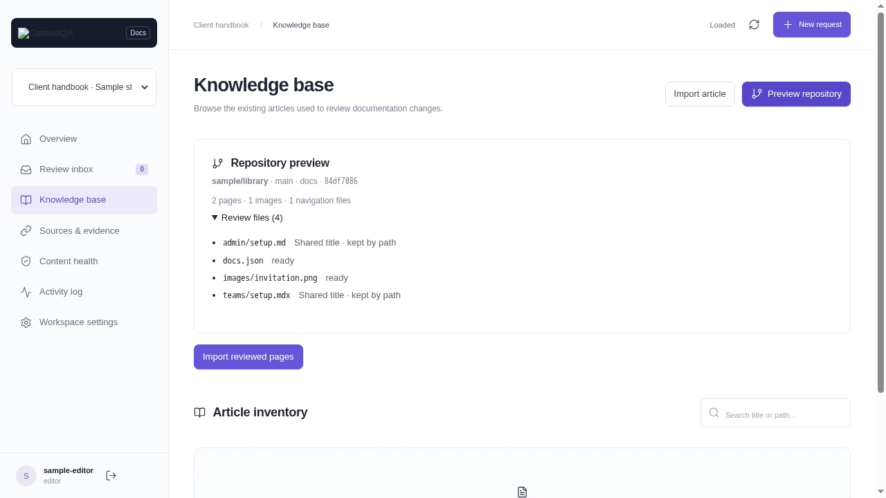
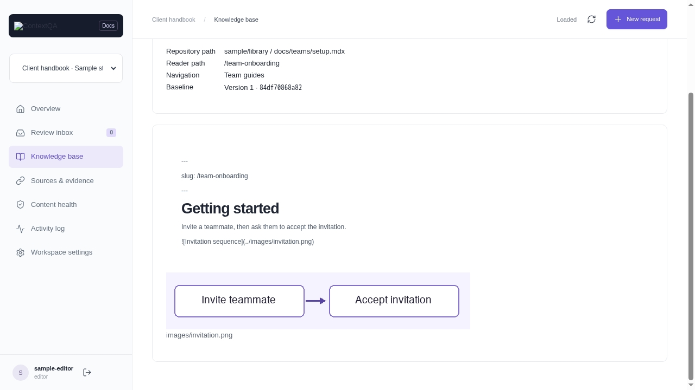
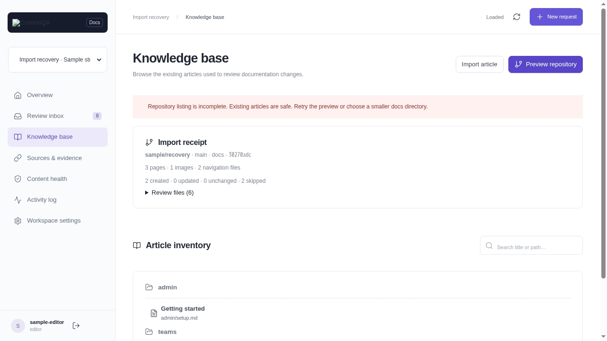

# Import existing documentation and find an article

Use **Knowledge base** to bring the client's existing documentation into your workspace. As an administrator, connect the documentation repository, branch and directory under **Workspace settings → GitHub**. An editor or administrator can then preview and import the files. [Connect a repository](m01-m02-operations.md)

## Preview and import the directory

1. Open **Knowledge base** and select **Preview repository**. Wait for **Repository preview**. Check the repository, branch, directory and commit against the source you meant to import.
2. Expand **Review files**. The sample contains two pages named **Getting started**. Their paths, `admin/setup.md` and `teams/setup.mdx`, keep them distinct. Check the image and navigation file too. Each unsupported file has its own explanation.

3. Select **Import reviewed pages**. Read the **Import receipt** for counts of created, updated, unchanged and skipped files. In this example, two pages were created. The folders under **Article inventory** contain the new baselines. [View the import receipt](m03-evidence/import-receipt.jpg)

## Find the article and its evidence

4. In **Search articles**, enter `teams/setup.mdx`. Open the matching **Getting started** result.
5. Inspect **Source version**. In this example, the repository path ends in `docs/teams/setup.mdx`, the reader path is `/team-onboarding`, the navigation group is **Team guides**, and the baseline shows **Version 1** with its commit. [View the source details](m03-evidence/source-version.jpg)
6. Scroll down to the article’s local illustration. The imported diagram shows **Invite teammate → Accept invitation**, with the asset path beneath it. Select **All articles** to return to the filtered list.

[Watch the import, search and figure inspection](m03-evidence/import-articles.mp4). Ship 5 case 204, result 473, checked these steps on the M03 build at 1280 × 720. The receipt maps each screenshot to its saved step. [Source case](https://ship-5.contextqa.com/td/cases/204/steps) · [Media provenance](m03-evidence/import-articles-provenance.json)

## Recover from an incomplete listing

If **Repository listing is incomplete** appears, your previous import receipt and existing articles remain available. Choose **Preview repository** to request a fresh listing. If the read fails partway through individual files and a pending preview exists, use **Resume reading files**.

In the recovery example, the new preview identifies an interactive MDX document and an invalid navigation file. Inspect their file-level messages before choosing **Import reviewed pages**. The receipt shows **0 created · 0 updated · 2 unchanged · 2 skipped**. An unsuccessful article search displays **No matching articles**. Clear the search to return to the inventory. [File warnings](m03-evidence/file-warnings.jpg) · [Unchanged receipt](m03-evidence/unchanged-receipt.jpg)

[Watch recovery and reimport](m03-evidence/retry-import.mp4). Ship 5 case 205, result 472, verified the listing failure and retry. Per-file resume was separately verified against PostgreSQL. [Source case](https://ship-5.contextqa.com/td/cases/205/steps) · [Media provenance](m03-evidence/retry-import-provenance.json)

## Check what changed on the next import

Preview the repository again after a source edit, then import the reviewed pages. In this example the receipt reports **1 updated · 1 unchanged**. Open the modified administrator article and inspect **Source version** and its new paragraph. The other article remains at version 1. [Before the edit](m03-evidence/before-version.jpg) · [After the edit](m03-evidence/after-version.jpg) · [Watch the changed baseline](m03-evidence/changed-baseline.mp4)

Ship 5 case 207, result 474, step result 857, verified the updated and unchanged articles on the same M03 bundle. [Source case](https://ship-5.contextqa.com/td/cases/207/steps) · [Media provenance](m03-evidence/changed-baseline-provenance.json)
