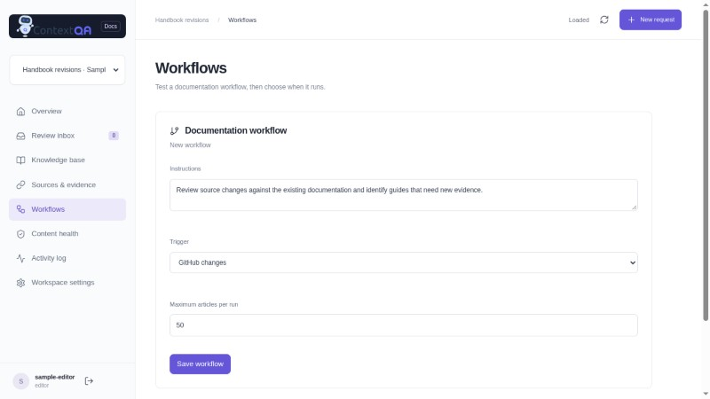
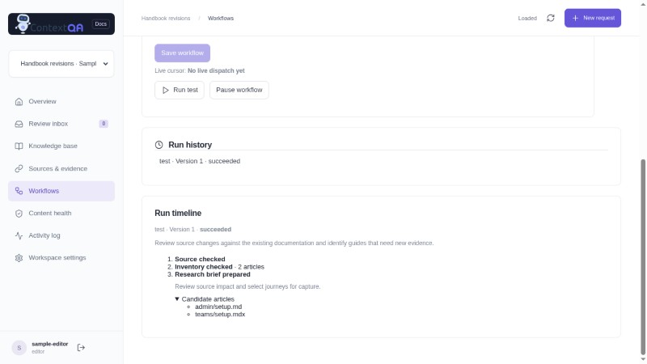
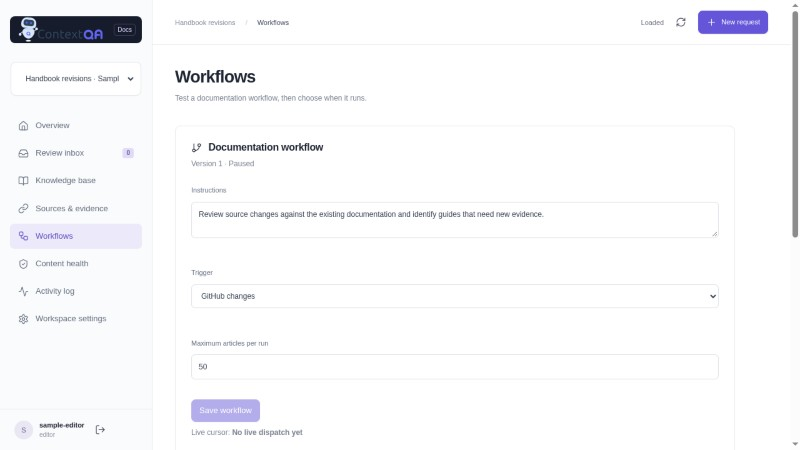
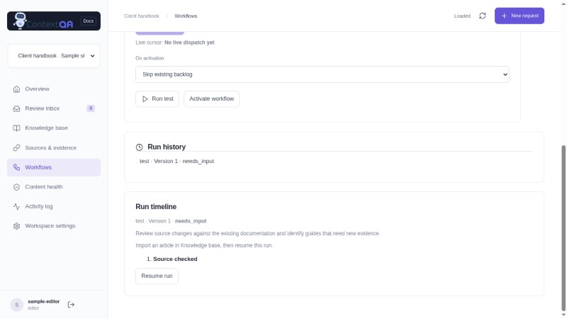
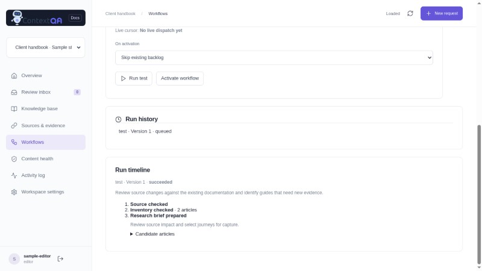
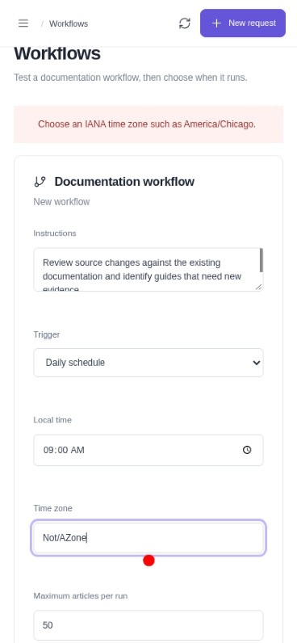

# Test and activate a documentation workflow

Use a test run to see which articles the workflow can use before you turn on its trigger. You need editor or administrator access and an imported documentation baseline. This guide follows the Ship 5 desktop run for case 208, result 477.

1. Open **Workflows** in your project. Enter the instructions, choose a trigger and set the maximum number of articles for a run. For a daily schedule, enter the local time and its IANA time zone. Save the configuration.

   

2. Select **Run test**. In **Run history**, open the new test and inspect its timeline. It checks the source, reads the inventory and prepares a research brief. Check which saved version ran and whether the three stages completed. The test leaves the live cursor unchanged.

   

   [Watch the workflow test](m04-evidence/workflow-test.mp4)

3. Activate the workflow when the test has the intended scope. Choose whether to process or skip the existing backlog. Use **Pause** when you want to suspend dispatch. Previously recorded runs remain in the history.

   

## Recover a run after importing documentation

If the source check succeeds and the inventory stage stops, read the reason in the run timeline. Import the baseline in **Articles**, then return to **Workflows**, open the same run and choose **Resume run**. The timeline shows the completed stages and keeps the original run ID. Ship 5 exercised this recovery in case 209, result 476.

[Watch the recovery](m04-evidence/workflow-recovery.mp4)

## Correct a schedule on mobile

If a time zone is rejected, correct the time zone in the form and save again. Ship 5 verified that a valid zone saved a paused workflow on a 390 × 844 viewport in case 210, result 475.

[Watch the schedule correction](m04-evidence/schedule-correction.mp4) · [Acceptance results](m04-results.md)
