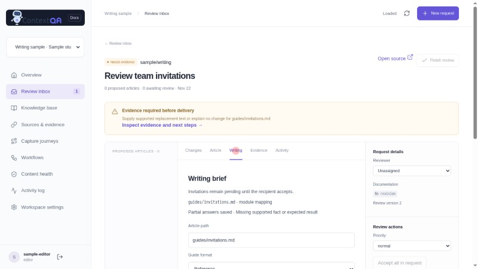
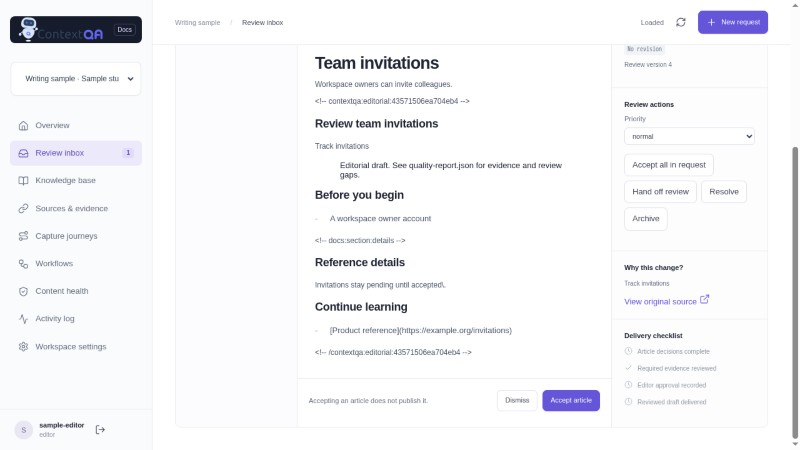
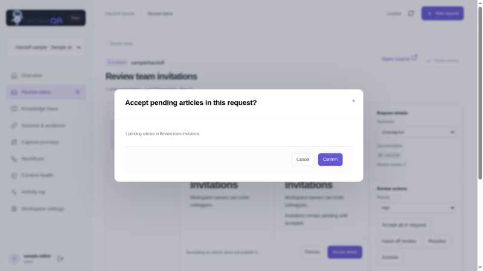
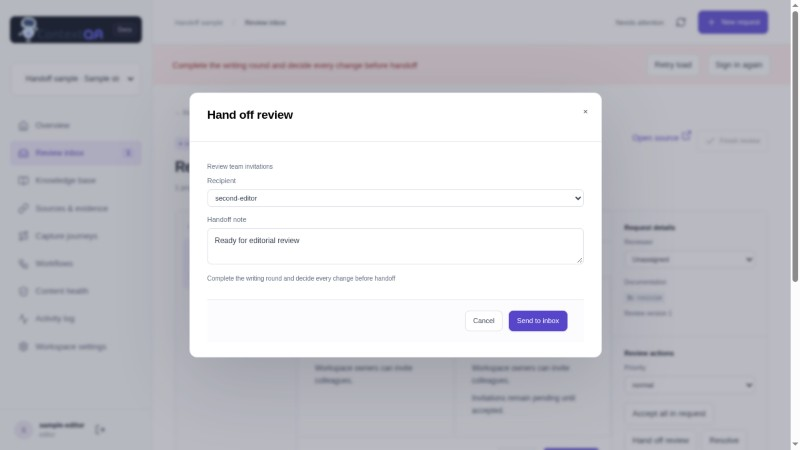
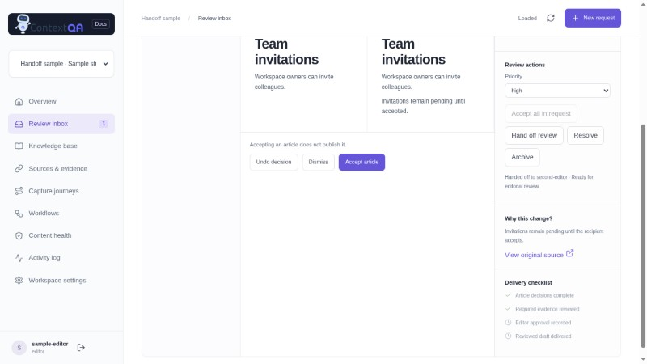
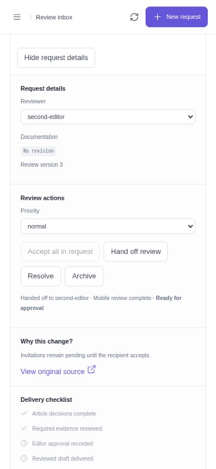

# Write a guide and hand it to a reviewer

A workspace editor can turn a product change into a proposed article. A reviewer can then decide which changes to keep and send the request to the next editor. The invitation example below uses a disposable workspace. Each screenshot comes from its Ship 5 recording.

## Write against an existing article

1. Open **Review inbox**, select the request, and open **Writing**. Check the suggested article path against the source description. Select **Reference** for a product fact or **Tutorial** for a procedure backed by a reviewed capture.
2. Enter the intended reader, goal, prerequisite, source URL, and supported fact. Use **Save partial answers** to return to an incomplete brief later. If you choose **Generate draft** with a missing fact, the form identifies what to supply.

3. Enter the missing fact and select **Save partial answers**. Reopen the request and verify your answer. In this example the fact was “Invitations stay pending until accepted.”
4. Select **Generate draft**, then **Article**. Verify the proposed section alongside the existing policy. **Changes** lets you compare the previous and proposed text. The imported baseline stays available during review.

The clip shows the transition from the saved brief to the proposed article. [Watch the writing clip](m05-evidence/writing-desktop.mp4) · [Inspect the Ship 5 writing run](https://ship-5.contextqa.com/run-result-view?testCaseId=215&runResultId=483)

## Decide the request and hand it off

1. Open the request, inspect **Changes** and **Evidence**, and check **Request details**. On a narrow screen, choose **Show request details**. Select a priority if the request needs attention.
2. Choose **Accept article** for the selected article, or **Accept all in request** for the request’s pending articles. The confirmation names the request and shows the number affected. **Confirm** records the decisions.

3. Under **Review actions**, select **Hand off review**. Choose another editor, enter a note explaining what they should review, and select **Send to inbox**. If any article still needs a decision, the handoff remains open with an explanation. Cancel, finish the review, and retry.

4. Verify **Ready for approval**, the recipient under **Reviewer**, and the handoff note. The receiving editor can find the request under **Assigned to me**. Approval and external delivery are separate actions.

The clip shows the handoff being submitted and the updated request. [Watch the handoff clip](m07-evidence/review-desktop.mp4) · [Inspect the Ship 5 reviewer run](https://ship-5.contextqa.com/run-result-view?testCaseId=216&runResultId=484)

## Check a handoff on mobile

Open **Show request details**, finish the request-level decisions, and send the handoff. Under **Review actions**, the receipt shows the recipient, note and **Ready for approval** together. This layout was verified at 390 × 844 after an earlier run missed the status while scrolled to the receipt.

[Watch the mobile handoff](m07-evidence/mobile-handoff.mp4) · [Inspect Ship 5 result 489](https://ship-5.contextqa.com/run-result-view?testCaseId=219&runResultId=489)

For writing on a narrow screen, open **Article** after generating the draft and read the updated invitation policy in context. [See the mobile draft](m05-evidence/mobile-draft.jpg) · [Watch the mobile writing flow](m05-evidence/writing-mobile.mp4) · [Inspect result 486](https://ship-5.contextqa.com/run-result-view?testCaseId=217&runResultId=486)
