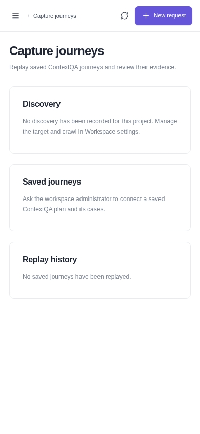

# M06 capture and replay

The **Capture journeys** page shows the latest discovery status, saved journey definitions, and independent replay history for the selected project. Editors can inspect a capture and approve its steps and evidence. Administrators can register a saved plan, approve a metered replay and check a stopped run. The hosted worker and UI are implemented locally. Release-bound acceptance with a customer's provider connection is open.

## Run a saved journey

1. In **Workspace settings**, configure the target application and product repository. A deployment operator binds the permitted ContextQA workspace, saved plans, credential, and media storage hosts to this project.
2. Open **Capture journeys** and select the journey. Check the environment, plan and case IDs. Select **Register saved definition**. Registration reads the provider's definitions. A change in the registry requires registration again.
3. Enter the deployed 40-character commit SHA, read the workspace metering terms, confirm, then select **Replay journey**. Save the run ID from **Replay details**. When the provider accepts the run, the worker records its ID in a private journal.
4. Inspect the result. A failed assertion yields an inconclusive capture. A missing deployment receipt or uncovered prerequisite appears under the stopped run. After correcting the cause select **Check original run**. This continues from the accepted provider run.
5. For a capture awaiting review, read the step instructions and download each linked screenshot or recording to check its contents. Confirm the instructions and media rights, then select **Approve capture**. Approval produces a private reviewed export for the writing module. The existing published article only changes through its separate delivery process.

## Deployment configuration

Apply migration 005. Run the API and `python -m cqa_artifacts.hosted.capture_worker` with the same database, private capture directory and server-owned connection file. Development Compose supplies the optional `capture` profile. Set `DOCS_CONNECTIONS_DIR` to the directory containing the configuration and `DOCS_CONNECTIONS_FILE=/run/docs-connections/connections.json` for the API. Both containers share `/data/captures`. Put the registry and deployment receipts inside the read-only configuration mount and reference their container paths. Restrict this mount to the API and worker service accounts.

The connection file is keyed by organization/project. Configure `app_url`, `workspace_version_id`, `capture_registry_file`, `capture_plan_ids`, `capture_api_token`, `capture_meter_note`, `capture_storage_hosts` and `deployment_receipt_directory`. Optional `coverage_gaps` maps a journey ID to outstanding prerequisites. Supply the workspace-scoped service credential through the deployment secret store. An app-under-test sign-in profile authenticates the browser journey. The worker's credential authenticates the API client.

A deployer writes an attributable receipt to `<run_id>.json` after identifying the serving build. Include the accepted run ID, full commit SHA, configured application URL and environment, digest of the registered journey, verifier identity, evidence reference and confirmation. Record the actual deployed revision from the deployment system. A repository head or a successful sign-in alone cannot identify the binary that served the journey.

## Acceptance coverage

| Criterion | Verification |
|---|---|
| AC-1 · Discovery and replay | Separate UI state and run history. A signed-in advanced portal journey was recorded in Ship 5, then replayed independently. Native entire-app onboarding crawl acceptance remains open. |
| AC-2 · Deployed commit | PostgreSQL regression stopped on unknown deployment. Added a matching receipt, checked the same accepted run, and reached review. Live deployer binding remains open. |
| AC-3 · Review protection | PostgreSQL checks rejected a stale review digest, hid unverified media, and denied cross-project access. The capture worker writes a private export. |
| AC-4 · Ambiguous start | Simulated interrupted start stopped for reconciliation. A missing journal stayed blocked. An attributable journal resumed the same provider run. Duplicate requests and configuration drift were checked before a charge. |
| AC-5 · Source evidence | The worker regression resolved selected media to case and step results, retrieved the file by checksum and approved the reviewed export. Live Ship 5 screenshots and a recording were separately checked in the client documentation pilot. |
| AC-6 · Coverage gaps | The worker withholds review until the deployment is verified and the configured prerequisite list is clear. An operator still needs to supply meaningful coverage requirements for each client. |

The hosted suite passed 34 tests against isolated PostgreSQL, the core suite passed 193 tests, the React suite passed 14 checks, and the production frontend build succeeded. The local provider regression uses a synthetic transport. The private client pilot used the real Ship 5 connector. The code-to-documentation pipeline still needs a worker-side connection, independently supplied deployed commit and verified review/delivery/refresh modules before production release.

## New workspace on mobile

Ship 5 case 213, result 480, completed with SUCCESS. Its one exploration step checked the new workspace at 390 × 844 on frontend bundle `index-MN8WapMW.js`. Open **Capture journeys**. With an empty configuration, **Discovery** identifies the missing crawl, **Saved journeys** explains who can connect a plan, and **Replay history** is empty. This run covers the visible setup state. The operator and worker checks above cover the separate metering and registration controls.

[Watch the new workspace view](m06-evidence/missing-plan.mp4) · [Media provenance](m06-evidence/missing-plan-provenance.json)
