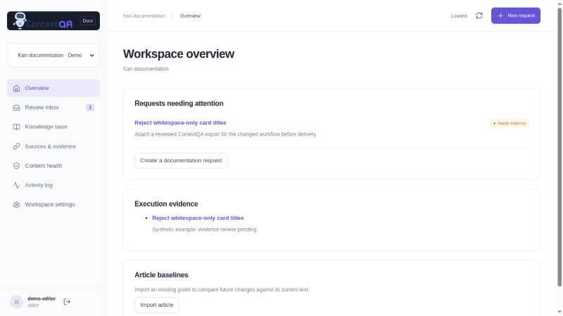

# Verify a guide published to GitHub Pages

Use this procedure for a public repository site published from a branch. The staging example uses the synthetic Kan workspace. The screenshot records the original editor interaction. The browser replay records a reader opening the resulting documentation.

1. In **Workspace settings → GitHub**, save the documentation repository, publishing branch and directory. In this example the branch is `staging-publish` and the directory is `docs`. An administrator needs the existing GitHub App installation with repository metadata, contents and Pages read access.
2. Select **Check Pages configuration**. Compare the reported site address, branch and directory with the approved destination. In GitHub, enable Pages branch publishing from that directory. This product check reads the configuration.
3. Put the reviewed static files and `release.json` on the docs branch through the team's review process. The manifest lists site-relative filenames and the SHA-256 of each file's exact published bytes, including `index.html`, the guide and its images. The pilot uses prebuilt HTML and a `.nojekyll` file. On a new build, wait for the expected documentation commit to appear in the provider receipt. [Example staging manifest](https://github.com/contextqaai/contextqa-docs-evidence/blob/7e2045414def6cacb88cfeb1690c9abec201c89d/docs/release.json)
4. Select **Verify deployed files**. The server reads the manifest from that exact commit, compares its public bytes and the bytes of every listed file, and checks the branch again. A missing image, digest mismatch, incomplete build or newer commit requires a fresh check. The initial verifier supports the default github.io address, up to 32 manifest entries, and branch publishing.
5. In ContextQA, run the anonymous reader journey. Open the guide from the landing page, check the edition and figure, then follow **All guides** back. Run the API companion to verify the edition, image response and missing-file status. Attach the recording and the provider build to the release report. [Live synthetic guide](https://contextqaai.github.io/contextqa-docs-evidence/guides/review.html)

The figure comes from [Ship 5 case 199, result 460](https://ship-5.contextqa.com/run-result-view?testCaseId=199&runResultId=460). The staging-only site's initial deployment placed those previously documented sample bytes on a new branch. Automatic conversion of an accepted SoFa Docs bundle into a reviewed Pages PR remains a separate acceptance criterion.

## Staging verification on 22 November 2026

| Check | Actual observation |
|---|---|
| Provider | GitHub built docs commit `7e2045414def6cacb88cfeb1690c9abec201c89d` from `staging-publish` and `/docs`. [Build 1393378957](https://api.github.com/repos/contextqaai/contextqa-docs-evidence/pages/builds/1393378957) |
| Published files | The product verifier compared the pinned release manifest and its three entries with anonymous responses. All four byte comparisons matched. This operator run used GitHub CLI authentication to read provider metadata. Workspace installation credential acceptance requires a configured installation. |
| Consumer browser | SUCCESS, one agent step passed, zero failed. The anonymous journey opened the guide, checked edition and figure, and returned. The run contains a recording. [Case 259, result 722](https://ship-5.contextqa.com/run-result-view?testCaseId=259&runResultId=722) |
| Consumer API | SUCCESS, three steps passed, zero failed. The edition matched, the image returned 200 and an absent image returned 404. [Case 260, result 715](https://ship-5.contextqa.com/run-result-view?testCaseId=260&runResultId=715) |
| Independent comparison | The public Cayman project-site navigation also passed in one agent step. [Case 258, result 708](https://ship-5.contextqa.com/run-result-view?testCaseId=258&runResultId=708) |
