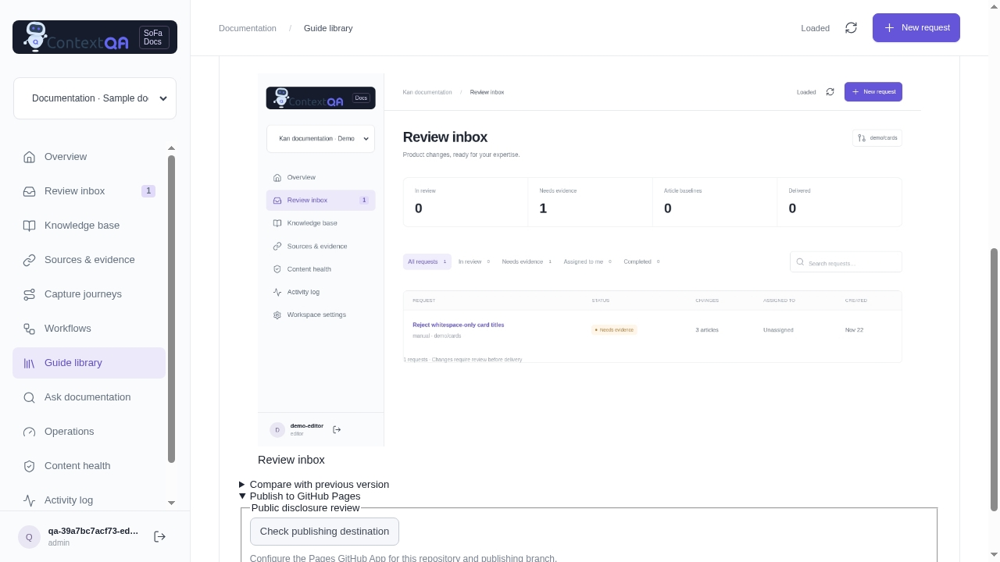

# Publish an approved guide to GitHub Pages

An organization administrator can open a draft PR for a current version in **Guide library**. The destination must use branch publishing and have an existing index with a main element and a valid release manifest. The staging destination is `contextqaai/contextqa-docs-evidence`, branch `staging-publish`, folder `/docs`.

## Connect the repository once

1. In the GitHub organization settings, register a private GitHub App for this organization. Give it repository **Contents** and **Pull requests** read/write, **Pages** read, and the default **Metadata** read permission. This publisher uses outgoing API calls. It needs no webhook subscription, organization permission or user authorization flow.
2. Install it using **Only select repositories** and choose **contextqaai/contextqa-docs-evidence**. Record its app ID and installation ID. Generate a private key for the worker and provision it through the deployment's secret manager.
3. In the trusted server configuration referenced by `DOCS_CONNECTIONS_FILE`, add a `pages_github_app` object under the existing organization/project key. Supply `repository`, `branch`, `app_id`, `installation_id`, and `app_private_key`. The worker expects PEM text in the mounted secret JSON. Keep that file outside the repository. Set the repository and branch to the exact values above. Leave the existing GitHub source connection in place.
4. In **Workspace settings → GitHub** choose the same repository, branch and folder and select **Check Pages configuration**. The worker requests a short-lived token for the selected repository. It requests write access only when creating the draft PR. Protect the publishing branch with the team's merge review rules. [GitHub App installation instructions](https://docs.github.com/en/apps/using-github-apps/installing-your-own-github-app)

## Review and open the PR

1. Save the approved article and its reviewed ContextQA media in the guide library. Open the current edition. Review every step and open each screenshot at original resolution. Play the recording and inspect it for internal information.
2. Expand **Publish to GitHub Pages** and select **Check publishing destination**. Verify the repository, branch, base commit and number of attachments.
3. Confirm public sharing and select **Open publishing draft PR**. Repository readers can access files as soon as the branch is created. A guide containing a recognized secret or internal-only marker requires a revised, approved edition. Human review covers unmarked business logic and private information visible in media.
4. Open the PR and review its changed guide, landing-page link, media and release manifest. After merge, use **Verify deployed files** and the Phase 10 reader journey. A newer guide or changed publishing base requires a fresh preview. A retry on the same preview reconciles its draft branch and existing PR.

The publisher copies the saved screenshot bytes and links the inline image to its original. The public renderer supports the saved guide’s evidence references. A link to another guide or external site requires review and currently blocks the handoff. The release manifest supports up to 32 files across the site.

## When the installation is missing

Open **Publish to GitHub Pages** and select **Check publishing destination**. If the app asks you to configure the Pages GitHub App, complete the repository installation above, then check the destination again. Ship 5 verified that an administrator on the synthetic preview reached this message and could not open a publishing PR. Select the image for the original 1280 × 720 screenshot. [Ship 5 case 265, result 735](https://ship-5.contextqa.com/run-result-view?testCaseId=265&runResultId=735)

