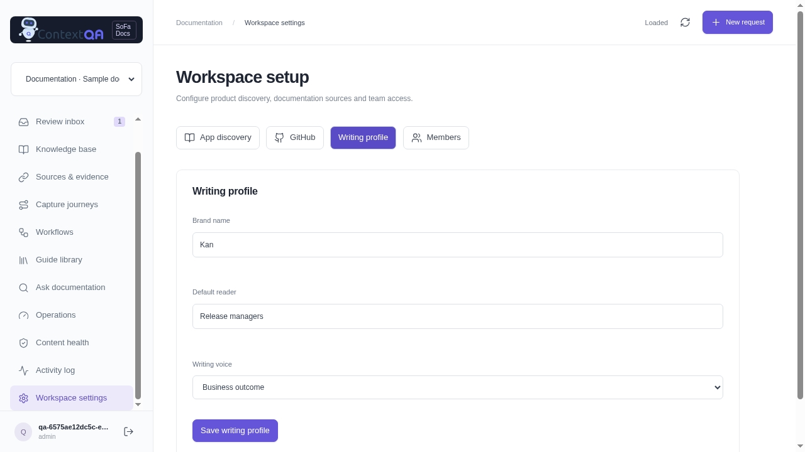

# Set the default reader and voice for a writing brief

A workspace administrator sets the product name, default audience and writing voice. Each saved change creates a revision. An editor can apply that revision to a writing brief and still adapt the audience to the task.

1. Open **Workspace settings** and select **Writing profile**.
2. Enter the public-facing product name in **Brand name** and the intended audience in **Default reader**. In the synthetic example, use **Kan** and **Release managers**.
3. Choose **Technical** or **Business outcome** in **Writing voice**. Select **Save writing profile** and check the revision in the confirmation. Reopen **Writing profile** to see the saved values.

   

   Ship 5 saved this profile and reopened it on the PR preview. The image shows the persisted values at the end of the journey. [Watch case 262, result 731](https://ship-5.contextqa.com/run-result-view?testCaseId=262&runResultId=731)

4. To use the defaults in an article, open its **Writing brief** and select **Apply workspace writing profile**. Check the intended reader and revision, complete the factual source and other required fields, then generate the draft. A reference draft uses the brand in its byline and the selected voice for its details heading. An existing pinned brief continues to use the revision it references.
5. If another administrator saved a newer revision while the form was open, choose **Reload profile**, compare the current values, then reapply the intended edit.

The two voice choices adjust the presentation of the supplied fact. A numeric business claim still needs its own source. This version handles guide writing. Editable slide decks and separate publication permissions per audience are subsequent modules.

Ship 5 covered steps 1–3. Local regression tests covered brief generation, pinned revisions and stale edits.
