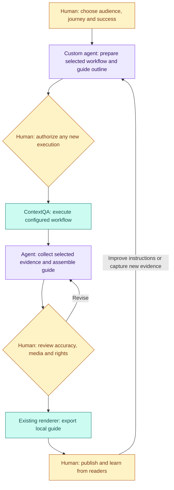

# Build a documentation steward on ContextQA

**You own the audience and the guide. ContextQA supplies workflow execution and evidence. This repository supplies reviewed local exports and comparisons.**

A documentation steward connects those building blocks around your team's process: which journey needs a guide, which evidence supports each instruction, who reviews it and what changes after a release. Reuse the existing execution and rendering tools; put your effort into the audience, decisions and handoffs.

[Try the operator workflow](how-to-use.md) · [Technical guide](POWERFUL.md) · [Test Forge builder repository](https://github.com/contextqaai/contextqa-test-forge)



## Reuse the foundation; customize the experience

| Reuse | Your custom contribution | Human ownership |
|---|---|---|
| ContextQA's selected native workflows, settings and results | Decide which journey/role/version needs documentation | Select meaningful scope, expected behavior and permitted execution |
| Existing collection, media attachment and annotation tools | Choose evidence and explicitly match it to instructions | Inspect accuracy, privacy and sharing rights |
| Existing Markdown/HTML/JSON export and before/after comparison | Apply audience/terminology and prepare a useful refresh packet | Accept the guide, publish separately and refine it from feedback |

Existing authorized results can be reused without starting a new run. Optional AI drafting is a separate helper that accepts text approved for sharing; it cannot approve evidence or publish. Your coordinator may be a script or assistant, but automatic instruction loading, full deployment-to-recapture orchestration and native destination publishing are not implemented here. The product capability map and a repository's callable interface are different inventories.

## See it and try it

From this repository root, use Python 3.10+ and a fresh directory:

```sh
python3 examples/contextqa_demo.py /tmp/NEW-my-documentation-agent
```

Inspect the simulated API-to-guide output. It demonstrates composition using the existing implementation without a live account, model call or real screenshot claim. The [usage guide](how-to-use.md) then walks through actual collection, explicit media matching, review, export and refresh. Preserve its selected result-ID hierarchy and review gates.

## Build it for your audience

1. **Name a useful job.** For example, “help new workspace admins create their first project,” with an owner, role and observable success criterion.
2. **Write the guide policy.** Adapt the [documentation style template](../examples/documentation-lifecycle/DOCUMENTATION_STYLE.md): audience, terminology, privacy exclusions, expected structure and reviewer. This is currently followed by the operator, not automatically loaded by the CLI.
3. **Select evidence.** Reuse a known ContextQA workflow and approved environment/data. Authorize a new run only if needed. Keep failed or missing evidence visible; do not invent successful steps.
4. **Compose the existing commands.** Use `contextqa-collect`, `add-step`, `add-media`, `attach`, `capture-context` and `annotate` as appropriate. Follow [exact API and run safety](contextqa-api.md); do not duplicate the client or renderer.
5. **Review and deliver.** A person reviews every selected instruction/frame/video and records approval. `export` writes local files; the owner chooses how and where to publish them.
6. **Refresh and optimize.** Preserve the baseline, obtain new reviewed evidence when behavior changes, map steps explicitly and run `compare`. Review the draft against both versions; revise the guide and learn from readers.

## Human review is also orchestration and improvement

| Moment | Agent prepares | Human contribution |
|---|---|---|
| Design | Proposed task and outline | Pick the audience, missing knowledge and definition of success |
| Orchestrate | Selected workflow and prerequisites | Coordinate role, environment, release timing, data and cost authorization |
| Review | Candidate instructions and explicit media mapping | Correct interpretation, remove sensitive content and confirm rights |
| Decide | Local export or refresh draft | Accept, revise, escalate or publish through the intended destination |
| Optimize | Reader feedback and repeat-task observations | Improve task coverage, wording, capture choices and review efficiency |

Example: a project-creation button changes. The coordinator prepares a new capture request; an owner confirms the correct deployed version and authorizes execution. ContextQA supplies the new evidence. The human checks the button label and selected frame before approval; comparison then helps review a refresh draft. A changed media hash is a review signal, not proof of a meaningful UI change.

Track whether readers complete the task, which instructions reviewers correct, missing evidence, time spent reviewing and the maintenance required after a change. Use those observations to choose the next automation step. Publishing, release decisions and unresolved content questions remain owned by named people.

## Expand without another platform

Keep native execution in ContextQA, rendering/comparison here, and source-to-test/portable-code workflows in [Test Forge](https://github.com/contextqaai/contextqa-test-forge). Its builder hub maps the supplied 54-capability system map to agent recipes and the continuous human loop. Reuse a supported MCP/API binding when available; verify the connected catalog and account access rather than guessing an operation from a product capability label.

This recipe follows the [pilot deck's building-block approach](https://docs.google.com/presentation/d/1Y8Z2Gkh3awvq1UUd2a3tDifxNZ1qudlwhifflToqxqk/edit?slide=id.p6#slide=id.p6). It adds an enablement path, not new runtime integrations. See [proof status](documentation-proof.md) for the scoped Kan evidence and remaining live acceptance work.

## Add a reporting skill to your agent

A reusable skill can turn reviewed ContextQA evidence into an audience-specific report. The companion [Test Forge repository](https://github.com/contextqaai/contextqa-test-forge) contains `skills/contextqa-report-builder/`, `skills/contextqa-report-review/` and `examples/custom-report/`: executive/QA profiles, fictional inputs and a local HTML/Markdown renderer. Reuse that presentation example rather than adding another execution client here.

Example request: “Use the report-builder skill with my selected evidence. Give the documentation owner a concise release summary, the changed tasks, missing screenshots and next review actions. Keep publication pending.” Use this wrapper's existing `export` and `compare` for the guide and refresh artifacts; adapt the reporting skill to summarize those artifacts rather than treating documentation steps as test-case passes. The example plan-report JSON schema is not this wrapper's export manifest, so an explicit mapping is required.

Let the owner customize audience, terminology, order and visuals. Preserve version/scope, review state, missing evidence and the distinction between a prepared draft and published documentation. Skills shape the assistant's workflow; they do not install integrations or approve publication.
