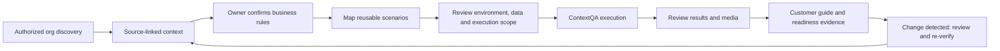

# Salesforce context, testing and learning center

For Salesforce admins, QA teams, implementation partners and business owners: understand the org, agree what should happen, adapt reusable scenarios, then verify and maintain the evidence.

**Starter release:** 24 candidate scenario specifications, eight learning modules, practical guides, three landing-page drafts and an offline preparation tool. These are not 24 executed tests, an all-cloud certification, or an autonomous implementation product.

## Start here

- [Customer onboarding and context pack](onboarding.md)
- [Client confidence handoff template](client-confidence-pack.md)
- [Prepare customer-specific scenarios](guides/adapt-assets.md)
- [Sales Cloud testing](guides/sales-cloud.md) · [Service Cloud testing](guides/service-cloud.md)
- [Flow and Apex verification](guides/flow-apex.md) · [Roles and permissions](guides/permissions.md)
- [Integrations and OAuth](guides/integrations.md) · [Release readiness](guides/release-readiness.md)
- [Create and maintain documentation from evidence](guides/documentation.md)
- [Learning pathway and assessment](learning/pathway.md)
- [Market research and positioning](research/market.md) · [Content plan](content-plan.csv)
- [Implementation and autonomous-agent boundaries](implementation.md)
- [Tutorial recording scripts](learning/recording-scripts.md)
- [Validation and remaining acceptance](validation.md)



Discovery identifies configuration. An owner supplies business intent. Execution establishes observed behavior for its recorded scope. None of these substitutes for the other two.

## Run the local starter

From this repository root, choose an unused output directory:

```sh
python3 scripts/salesforce-prepare.py \
  --context examples/salesforce/context.synthetic.json \
  --out /tmp/NEW-salesforce-preparation
```

The dated synthetic context intentionally becomes stale after 14 days. To repeat the simulation later, copy the fixture outside Git and update its `capturedAt` to the current date, clearly retaining its synthetic label. Never freshen a real snapshot's timestamp without a new collection.

Output: a private scenario manifest and a draft guide in this repo's existing documentation format. It does not create ContextQA cases, call Salesforce, execute tests, approve a guide, or publish anything. The example has one reviewable scenario; the others explicitly show missing context.

## Coverage map

| Area | Starter coverage | Additional context needed |
| --- | --- | --- |
| Sales Cloud | Lead, opportunity and quote candidate scenarios | Matching rules, stage gates, quote model and owner policies |
| Service Cloud | Case intake, closure, escalation and reopening | Routing, service windows, entitlements and notification rules |
| Platform | Flow/Apex, persona and field access | Full automation definitions, approved personas and expected behavior |
| Integrations | OAuth, order mapping, retry and duplicates | Both systems, middleware, contracts and isolated test data |
| Releases | Advisory applicability and environment drift | Intended release environment and fresh regression evidence |
| Documentation | Selected result import and review/refresh workflow | Actual results and separately reviewed media |
| CPQ / Revenue Cloud | Mapping boundary explained; generic quote scenarios only | Product/version-specific objects, pricing and approvals; no equivalence assumed |
| Marketing, Commerce, Experience, Data and industry products | Future content scope | Product-specific APIs, licensing, configuration and domain review |

Learn about [ContextQA](https://contextqa.com/?utm_source=github&utm_medium=developer_referral&utm_campaign=contextqa_docs_evidence&utm_content=salesforce_center). Evaluate a bounded process before expanding coverage. No free-credit, guaranteed ROI or all-org compatibility claim is made.
