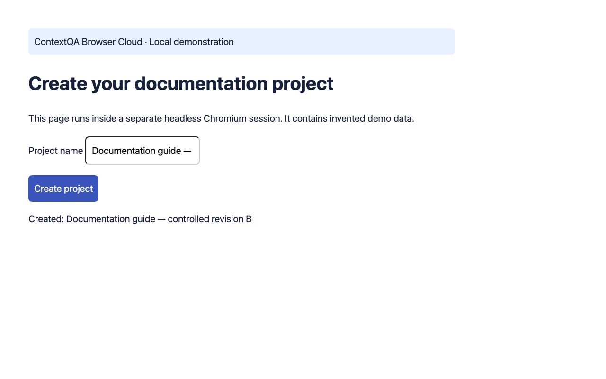

# Local browser walkthrough — observed task completion

Reviewed workflow evidence; verify the target product version before publishing.

## 1. Start a local synthetic browser session

Purpose: create a documentation project\. Preconditions: run the private Browser Cloud loopback demo; no external account, AI key or customer data\. Select Start demo session\. Observed baseline: No project created yet\. Captured 2026\-10\-27; same application build throughout\.

## 2. Create the controlled demo project

Set Text to enter to Documentation guide — controlled revision B, then select Run demo task\. The service fills \#name and clicks \#create\. Select Read page text and Save screenshot\. Observed exact result: Created: Documentation guide — controlled revision B\. End the session to finalize video\. This is a controlled state change in one synthetic app build, not a product release or Layerpath/EkLine integration\.

