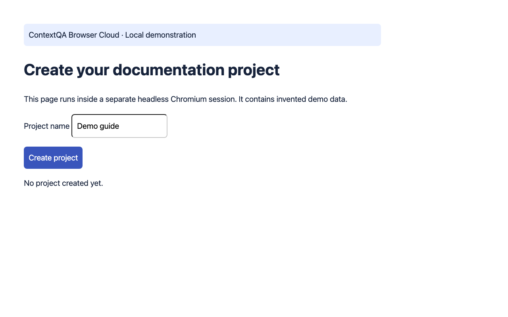

# Local browser walkthrough — baseline, task not executed

Reviewed workflow evidence; verify the target product version before publishing.

## 1. Start a local synthetic browser session

Purpose: create a documentation project\. Preconditions: run the private Browser Cloud loopback demo; no external account, AI key or customer data\. Select Start demo session\. Observed baseline: No project created yet\. Captured 2026\-10\-27; same application build throughout\.

## 2. Baseline task state — not yet executed

This is a baseline capture, not a passing test or completed workflow\. The project name is Demo guide and the page states No project created yet\.

